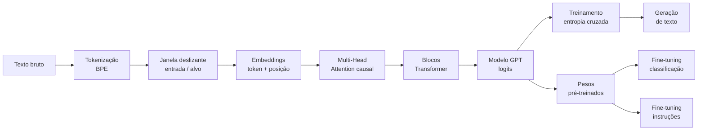

# MegaBrain — Relatório Técnico Final

**Construção de um Large Language Model do zero** · Capítulos 1 a 7 de RASCHKA, S. *Build a Large
Language Model (From Scratch)*, Manning. · Davy Josias Scheuermann e Lucas Tessari De Giacometi

---

## 1. O que foi construído

Um modelo de linguagem da família GPT, implementado componente a componente em PyTorch, sem usar
modelos prontos nem serviços de API: do tokenizador ao fine-tuning. O mesmo código que, na Sprint 4,
produzia tokens ao acaso com pesos aleatórios, termina o projeto:

- **treinado do zero** num conto de 20 mil caracteres (Sprint 5);
- **carregado com os pesos do GPT-2 124M** publicados pela OpenAI, escrevendo inglês gramatical
  (Sprint 6);
- **ajustado para classificar** SMS como spam, com 98,1% de acerto em mensagens que nunca viu
  (Sprint 6);
- **ajustado para responder a instruções**, parando sozinho ao fim da resposta (Sprint 6).

O objetivo nunca foi competir com modelos comerciais, e sim abrir a caixa-preta: cada etapa tem código
próprio, testes contra os valores do livro, experimentos e análise.



O pipeline inteiro roda de ponta a ponta, só com os módulos de `src/`, em cerca de um minuto de CPU:

```bash
uv run python src/demonstracao_pipeline.py
```

## 2. O pipeline, etapa por etapa

| Etapa | Entrada → saída | Módulo | Sprint | Verificações |
|---|---|---|---|---|
| Tokenização | texto → token IDs | [`tokenizacao.py`](../src/tokenizacao.py) | 2 | [`validar_dados.py`](../src/validar_dados.py) — 38 |
| Dataset e DataLoader | token IDs → lotes `(b, L)` de entrada e alvo | [`dados.py`](../src/dados.py) | 2 | idem |
| Embeddings | `(b, L)` → `(b, L, d)` | [`embeddings.py`](../src/embeddings.py) | 2 | idem |
| Atenção | `(b, L, d)` → `(b, L, d)`, cada token olhando só para trás | [`attention.py`](../src/attention.py) | 3 | [`validar_atencao.py`](../src/validar_atencao.py) — 28 |
| Arquitetura GPT | `(b, L)` → logits `(b, L, V)` | [`gpt.py`](../src/gpt.py) | 4 | [`validar_gpt.py`](../src/validar_gpt.py) — 38 |
| Geração | logits → próximo token, repetidamente | [`geracao.py`](../src/geracao.py) | 4 e 5 | idem |
| Treinamento | lotes → pesos ajustados | [`treinamento.py`](../src/treinamento.py), [`checkpoint.py`](../src/checkpoint.py) | 5 | [`validar_treinamento.py`](../src/validar_treinamento.py) — 27 |
| Pesos pré-treinados | arquivo do GPT-2 → `GPTModel` | [`pesos_pretreinados.py`](../src/pesos_pretreinados.py) | 6 | [`validar_fine_tuning.py`](../src/validar_fine_tuning.py) — 56 |
| Classificação | mensagem → classe | [`classificacao.py`](../src/classificacao.py) | 6 | idem |
| Instruções | pedido → resposta | [`instrucoes.py`](../src/instrucoes.py) | 6 | idem |

Cada módulo reaproveita os anteriores sem reescrevê-los: o `GPTModel` usa a `MultiHeadAttention` da
Sprint 3 e o `EmbeddingDeEntrada` da Sprint 2; o fine-tuning de instruções usa o `treinar_modelo` da
Sprint 5 sem nenhuma alteração.

## 3. O que cada sprint mostrou

Os números abaixo vêm das execuções registradas em [`results-by-sprints/`](../results-by-sprints/); a
análise completa está no relatório de cada sprint.

### Sprint 1 — fundamentos ([relatório](sprint01-relatorio.md))

Leitura do Capítulo 1 e do Apêndice A, mapa conceitual da arquitetura GPT e ambiente validado. O GPT é
um Transformer só com a pilha de decodificadores, treinado para uma tarefa única — prever o próximo
token —, da qual as demais capacidades emergem.

### Sprint 2 — processamento de texto ([relatório](sprint02-relatorio.md))

- **O tokenizador decide o que o modelo pode ver.** O tokenizador por palavras perde tudo o que está
  fora do vocabulário; o BPE reconstrói qualquer texto, ao custo de mais tokens para o que é raro.
- **O português custa 50% mais tokens por palavra** que o inglês no BPE do GPT-2.
- **Sem embedding posicional, a ordem não existe** para o modelo.

### Sprint 3 — mecanismos de atenção ([relatório](sprint03-relatorio.md))

- **A escala `1/√d_k` é indispensável:** sem ela, com `d_k = 2048`, o softmax entrega 97% da atenção a
  um único token e o gradiente cai 22 vezes.
- **A máscara causal é exata:** uma perturbação num token futuro produz variação zero nos anteriores.
- **Várias cabeças custam tempo, não parâmetros:** de 1 para 16 cabeças, os mesmos 36.960 parâmetros e
  9,4 vezes o tempo.

### Sprint 4 — arquitetura GPT ([relatório](sprint04-relatorio.md))

- **O bloco preserva a forma `(b, L, d)`** e por isso pode ser empilhado.
- **Em modelos pequenos, o vocabulário é o maior custo:** tabela de tokens e cabeça de saída somam 47%
  dos parâmetros do GPT-2 small.
- **Conexões residuais e LayerNorm são complementares:** sem as duas, o gradiente que chega ao primeiro
  de 24 blocos é zero.
- **Sem treino, nenhuma estratégia de geração produz texto com sentido.**

### Sprint 5 — treinamento ([relatório](sprint05-relatorio.md))

- **O laço funciona:** o GPT-2 124M, do zero, vai de perda 10,99 a 0,83 em 10 épocas.
- **Com 5 mil tokens, o modelo decora:** a perda de validação estaciona em ≈ 6,2 (perplexidade ≈ 500)
  em qualquer configuração. Mais épocas, taxa maior ou modelo maior só aceleram a memorização.
- **A decodificação não substitui o treino:** temperatura e top-k trocam cópia por diversidade, mas só
  dentro do que os pesos aprenderam.

### Sprint 6 — pesos pré-treinados e fine-tuning ([relatório](sprint06-relatorio.md))

| Medida | Resultado |
|---|---|
| Perplexidade em `the-verdict.txt`, pesos aleatórios → pesos do GPT-2 | 58.916 → 41,9 |
| Classificador de spam, acurácia no teste, antes → depois do ajuste | 45,4% → 98,1% |
| Precisão / revocação / F1 do classificador ajustado | 99,1% / 96,6% / 0,979 |
| Só a cabeça × último bloco × 6 blocos treináveis (acurácia no teste) | 83,6% × 98,1% × 99,2% |
| Classe lida no primeiro token, em vez do último | 64,5% |
| Instruções: perda de validação, antes → depois do ajuste | 4,10 → 0,78 |
| Instruções: F1 de palavras no teste, antes → depois | 0,203 → 0,528 |
| Instruções: palavras por resposta, antes → depois (esperado: 8,4) | 23,9 → 8,5 |

- **O conhecimento está nos pesos.** Nenhuma linha de `gpt.py` mudou entre o modelo que escreve ruído e
  o que escreve inglês.
- **Fine-tuning é barato porque parte de um modelo que já sabe a língua:** cerca de 900 exemplos e de
  15 a 40 minutos de CPU bastaram para as duas tarefas, contra semanas de GPU do pré-treino original.
- **A máscara causal da Sprint 3 explica uma decisão da Sprint 6:** a classe é lida no último token
  porque só ele enxerga a mensagem inteira.

## 4. O fio condutor

Três ideias atravessam o projeto e só ficam completas no final:

1. **Um único objetivo, prever o próximo token, sustenta tudo.** A entropia cruzada da Sprint 5 é a
   mesma do fine-tuning de instruções; a classificação troca só a última camada e a posição onde a
   perda é lida.
2. **A arquitetura define o que é possível; os pesos, o que acontece.** Sprints 2 a 4 construíram a
   máquina; a Sprint 5 mostrou que ela aprende, mas que 5 mil tokens só dão para decorar; a Sprint 6
   mostrou o que a mesma máquina faz com pesos treinados em escala.
3. **Dados pequenos pedem um ponto de partida grande.** Treinar do zero com poucos dados leva à
   memorização (Sprint 5). Partir de pesos pré-treinados e ajustar pouco — poucas camadas, poucas
   épocas — generaliza (Sprint 6).

## 5. Limitações

- **Recursos computacionais.** A Sprint 6 foi executada em CPU, com 7,5 GB de RAM. O fine-tuning de
  instruções usou o GPT-2 124M com 6 blocos treináveis, e não o 355M inteiro do livro; o experimento de
  congelamento não incluiu o modelo inteiro.
- **Dados.** As pastas de dados da disciplina exigem login e não foram acessadas; o projeto usa os
  dados do livro (`the-verdict.txt`, *SMS Spam Collection*, `instruction-data.json`). As duas bases da
  Sprint 6 tiveram as repetições removidas antes da divisão, o que as torna um pouco menores que as do
  livro.
- **Avaliação das respostas.** Correspondência exata e F1 de palavras medem semelhança de texto, não
  correção. O LLM juiz do Capítulo 7 não foi usado; a análise de correção é por leitura de amostras.
- **Escala do modelo de instruções.** O modelo responde no formato certo e para sozinho, mas erra o
  conteúdo com frequência: é um modelo de 124 milhões de parâmetros ajustado em 913 exemplos.
- **Um único treino por configuração.** Os experimentos da Sprint 6 usam uma semente; diferenças de 1 a
  2 pontos de acurácia num teste de 262 mensagens (cada mensagem vale 0,4 ponto) não são conclusivas.
- **Fora do escopo:** LoRA (Apêndice E), *warmup* e decaimento da taxa de aprendizado (Apêndice D) e
  modelos maiores que o 124M.

## 6. Como reproduzir

Requisitos: [uv](https://docs.astral.sh/uv/) e Python 3.14. A partir da raiz do repositório:

```bash
uv sync
```

Validação de todas as etapas (187 verificações, em CPU):

```bash
uv run python src/validar_dados.py
```

```bash
uv run python src/validar_atencao.py
```

```bash
uv run python src/validar_gpt.py
```

```bash
uv run python src/validar_treinamento.py
```

```bash
uv run python src/validar_fine_tuning.py
```

Pipeline completo, em versão reduzida e com os modelos ajustados:

```bash
uv run python src/demonstracao_pipeline.py
```

```bash
uv run python src/demonstracao_pipeline.py --completo
```

A versão `--completo` usa os checkpoints de `modelos/`, que não são versionados (têm de 510 a 665 MB
cada). Para gerá-los: `treinar_classificador.py` e `treinar_instrucoes.py`, em
[`experiments/sprint06-fine-tuning/`](../experiments/sprint06-fine-tuning/). Os experimentos de cada
sprint têm um `executar_todos.py` na pasta correspondente de [`experiments/`](../experiments/).

## 7. Onde está cada coisa

| O quê | Onde |
|---|---|
| Código dos componentes | [`src/`](../src/) |
| Experimentos por sprint | [`experiments/`](../experiments/) |
| Figuras, tabelas, logs e amostras | [`results-by-sprints/`](../results-by-sprints/) |
| Relatórios por sprint | [`reports/`](.) |
| Notebooks didáticos | [`notebook/`](../notebook/) |
| Glossário por capítulo e consolidado (160 termos) | [`technical-glossary/`](../technical-glossary/), [`glossario-consolidado.md`](../technical-glossary/glossario-consolidado.md) |
| Enunciados e planos das sprints | [`documentation/`](../documentation/) |

## Referência

RASCHKA, Sebastian. **Build a Large Language Model (From Scratch)**. Manning Publications.
