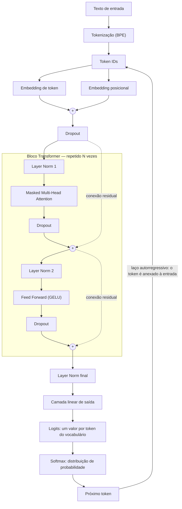
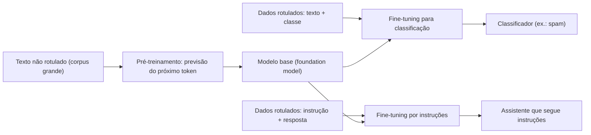

# Sprint 1 — Fundamentos de Large Language Models

**Capítulo 1 — *Understanding Large Language Models*** · RASCHKA, S. *Build a Large Language Model (From
Scratch)*, Manning.

---

## 1. Objetivo

A Sprint 1 é conceitual: não implementa componentes do modelo, mas estabelece o vocabulário e a visão
de conjunto que orientam todas as sprints seguintes. Os objetivos foram:

- compreender o que é um LLM e onde ele se situa em relação a IA, machine learning e deep learning;
- entender as duas etapas de construção de um LLM — pré-treinamento e fine-tuning;
- conhecer a arquitetura Transformer e a variante *decoder-only* usada pelo GPT;
- elaborar o glossário técnico do capítulo e um **mapa conceitual da arquitetura GPT**, relacionando
  cada bloco do mapa à sprint em que ele será implementado.

---

## 2. Leitura — síntese do capítulo

**O que é um LLM.** Um LLM é uma rede neural profunda treinada em uma quantidade muito grande de texto
para processar e gerar linguagem humana. O adjetivo *large* tem dois sentidos: o número de parâmetros
(dezenas a centenas de bilhões) e o tamanho do corpus de treinamento. Quando se diz que um LLM
"entende" texto, o sentido é operacional — ele produz respostas coerentes e adequadas ao contexto —,
e não uma afirmação sobre consciência.

**Onde ele se encaixa.** A IA é o campo mais amplo e inclui abordagens que não aprendem com dados,
como sistemas especialistas e lógica fuzzy. O machine learning é o ramo da IA em que o comportamento é
aprendido a partir de exemplos, e não programado regra a regra. O deep learning é o ramo do machine
learning que usa redes neurais com várias camadas e dispensa a extração manual de características. Os
LLMs são uma aplicação de deep learning a dados de texto.

**O que mudou no NLP.** Os métodos anteriores funcionavam bem em tarefas de classificação e de
reconhecimento de padrões simples, mas falhavam em tarefas que exigem compreensão de contexto e
geração de texto. Além disso, cada modelo era construído para uma tarefa. Os LLMs mudaram as duas
coisas: um mesmo modelo executa tradução, resumo, classificação e redação. O capítulo atribui esse
salto a dois fatores combinados — a arquitetura Transformer e o volume de dados de treinamento.

**Como um LLM é construído.** Em duas etapas. No **pré-treinamento**, o modelo aprende a prever a
próxima palavra em um corpus grande de texto não rotulado; como o rótulo de cada posição é a própria
palavra seguinte, o aprendizado é autossupervisionado e dispensa anotação humana. O resultado é um
**modelo base**, capaz de completar texto. No **fine-tuning**, esse modelo é treinado em um conjunto
menor e rotulado — pares instrução/resposta, ou textos com classes — para se especializar.

**A arquitetura.** O Transformer original (2017) tem um encoder, que lê a frase de entrada, e um
decoder, que gera a saída palavra por palavra; ambos se apoiam em self-attention. O BERT usa só o
encoder e é treinado para recuperar palavras mascaradas, o que o torna bom em classificação. O GPT usa
só o decoder, processa o texto da esquerda para a direita e gera de forma autorregressiva — cada token
gerado volta como entrada para gerar o próximo. Apesar da tarefa de treino simples, o GPT exibe
**comportamentos emergentes**, como traduzir sem ter sido treinado para isso, e pode ser usado em
modo *zero-shot* ou *few-shot*.

**O plano do livro.** O capítulo termina com o roteiro em três estágios que este projeto segue:
(1) preparar os dados, implementar a atenção e montar a arquitetura; (2) pré-treinar o modelo e
avaliá-lo; (3) fazer fine-tuning para classificação e para seguir instruções.

---

## 3. Mapa conceitual da arquitetura GPT

### 3.1 Diagrama

O mapa mostra o caminho de um texto pelo modelo durante a **geração**, incluindo o laço
autorregressivo. A região tracejada é o bloco Transformer, que se repete `N` vezes (12 no GPT-2
pequeno, configuração que será usada na Sprint 4).

### 3.2 Os blocos do mapa

**Tokenização e token IDs.** O texto é quebrado em tokens — palavras, pedaços de palavras e
pontuação — e cada token é trocado pelo seu índice no vocabulário. O GPT-2 usa o tokenizador BPE,
com vocabulário de 50.257 tokens. *Capítulo 2, Sprint 2.*

**Embeddings de token e posicionais.** Cada token ID vira um vetor treinável (embedding de token). Como
a atenção, sozinha, não percebe a ordem dos tokens, soma-se a ele um segundo vetor que depende apenas
da posição (embedding posicional). A soma é a representação de entrada do modelo. *Capítulo 2,
Sprint 2.*

**Masked multi-head attention.** Cada token constrói um vetor de contexto ponderando os tokens
anteriores e a si mesmo. A máscara causal impede o acesso a tokens futuros — condição para que o
modelo aprenda a *prever* o próximo token, e não a copiá-lo. Várias cabeças operam em paralelo, cada
uma com suas próprias projeções. *Capítulo 3, Sprint 3 — já implementada em
[`src/attention.py`](../src/attention.py).*

**Layer normalization, feed forward e conexões residuais.** A layer norm reescala as ativações de cada
token para estabilizar o treinamento. A rede feed forward processa cada posição individualmente,
expandindo e recomprimindo a dimensão do vetor. As conexões residuais somam a entrada de cada
subcamada à sua saída, o que facilita a passagem do gradiente em redes profundas. Juntos com a
atenção, formam o **bloco Transformer**, empilhado `N` vezes. *Capítulo 4, Sprint 4.*

**Layer norm final, camada de saída e logits.** Após o último bloco, uma layer norm final e uma camada
linear projetam o vetor de cada posição para o tamanho do vocabulário. Cada valor (logit) é a
pontuação de um token candidato; o softmax converte essas pontuações em probabilidades. *Capítulo 4,
Sprint 4.*

**Próximo token e laço autorregressivo.** Escolhe-se um token a partir da distribuição — o mais
provável, ou um sorteio controlado. Ele é anexado à sequência, e o modelo é executado novamente. O
laço se repete até atingir o número de tokens desejado. *Geração simples no Capítulo 4 (Sprint 4);
estratégias de decodificação no Capítulo 5 (Sprint 5).*

| Bloco | Capítulo | Sprint | Situação no repositório |
|---|---|---|---|
| Tokenização e token IDs | 2 | 2 | [`src/tokenizacao.py`](../src/tokenizacao.py) — `TokenizadorSimples`, `TokenizadorBPE` |
| Embeddings de token e posicionais | 2 | 2 | [`src/embeddings.py`](../src/embeddings.py) — `EmbeddingDeEntrada` |
| Masked multi-head attention | 3 | 3 | [`src/attention.py`](../src/attention.py) — `MultiHeadAttention` |
| Layer norm, feed forward, residuais, bloco Transformer | 4 | 4 | a implementar |
| Layer norm final, camada de saída, logits | 4 | 4 | a implementar |
| Geração autorregressiva | 4 e 5 | 4 e 5 | a implementar |

### 3.3 Etapas de construção

O mapa anterior descreve *o que* o modelo calcula. O diagrama abaixo descreve *como* ele chega a ter
pesos úteis.

| Estágio do livro | Conteúdo | Capítulos | Sprints |
|---|---|---|---|
| 1 — Construção | preparação dos dados, atenção, arquitetura GPT | 2, 3 e 4 | 2, 3 e 4 |
| 2 — Pré-treinamento | laço de treino, função de perda, avaliação, geração; carregamento de pesos abertos | 5 | 5 |
| 3 — Fine-tuning | classificação e instruções | 6 e 7 | 6 |

### 3.4 GPT × Transformer original × BERT

| | Transformer original | BERT | GPT |
|---|---|---|---|
| Partes usadas | encoder + decoder | só encoder | só decoder |
| Direção de leitura | encoder: ambos os lados; decoder: só o passado | ambos os lados | só o passado (esquerda → direita) |
| Tarefa de treino | tradução | previsão de palavras mascaradas | previsão da próxima palavra |
| Ponto forte | tradução | classificação e compreensão | geração de texto |
| Escala de referência | blocos repetidos 6 vezes | — | GPT-3: 96 camadas, 175 bilhões de parâmetros |

---

## 4. Ambiente (Apêndice A)

O Apêndice A apresenta o PyTorch, a biblioteca usada em todo o projeto. A familiaridade com ele foi
verificada na prática pelo script [`src/verificar_ambiente.py`](../src/verificar_ambiente.py), que
exercita exatamente os tópicos do apêndice:

| Verificação | Tópico do apêndice |
|---|---|
| versão do Python (≥ 3.10) e do PyTorch; disponibilidade de CUDA | instalação |
| criação de um tensor `2 × 3` | criação de tensores |
| transposição para `3 × 2` | manipulação de dimensões |
| produto `tensor @ tensor.T` comparado ao resultado esperado | operações matriciais |
| derivada de `y = x²` em `x = 3` calculada por `backward()` (esperado: 6) | autograd |
| rede `Linear(3, 4) → ReLU → Linear(4, 1)` com 21 parâmetros | construção de modelos com `nn.Module` |

As respostas escritas aos tópicos do apêndice estão no notebook
[`sprints/Sprint-1.ipynb`](../sprints/Sprint-1.ipynb).

---

## 5. Limitações e próximos passos

- Nenhum componente foi implementado nesta sprint; o mapa conceitual é uma previsão da arquitetura e
  será conferido contra o modelo real quando o `GPTModel` for montado na Sprint 4.
- Os números de escala citados (GPT-3, Transformer original) vêm do livro e servem apenas como
  referência de ordem de grandeza; o modelo deste projeto será várias ordens de grandeza menor.
- Os conceitos de tokenização, embeddings e atenção aparecem aqui só em nível introdutório; seus
  glossários próprios estão em [`technical-glossary/`](../technical-glossary/).

---

## 6. Entregáveis da Sprint 1

| Entregável | Onde |
|---|---|
| Leitura orientada — respostas às questões do capítulo e do Apêndice A | [`sprints/Sprint-1.ipynb`](../sprints/Sprint-1.ipynb) |
| Glossário do Capítulo 1 | [`technical-glossary/capitulo-01.md`](../technical-glossary/capitulo-01.md) |
| Mapa conceitual da arquitetura GPT | seção 3 deste relatório |
| Tradução manual do capítulo, de apoio à leitura | [`documentation/manual-translation/`](../documentation/manual-translation/) |
| Ambiente validado | [`src/verificar_ambiente.py`](../src/verificar_ambiente.py) |
| Quiz 1 | avaliação individual, aplicada pelo componente curricular |

---

## Referência

RASCHKA, Sebastian. **Build a Large Language Model (From Scratch)**. Manning Publications.
Capítulo 1 — *Understanding Large Language Models*; Apêndice A — *Introduction to PyTorch*.
