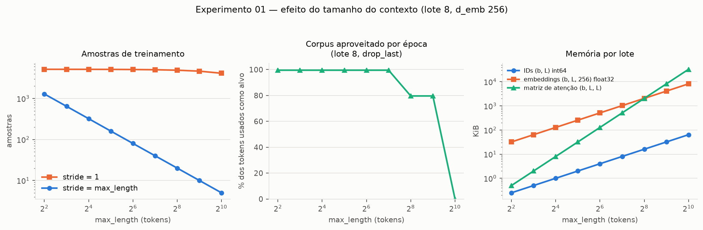
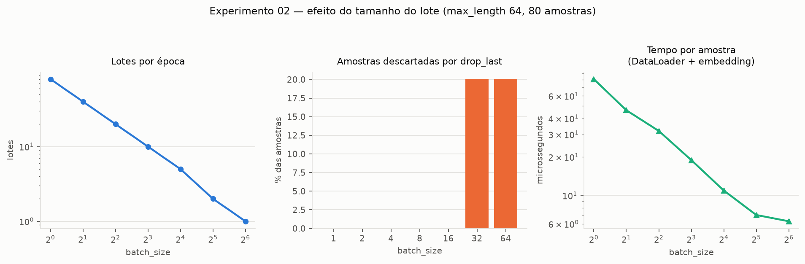
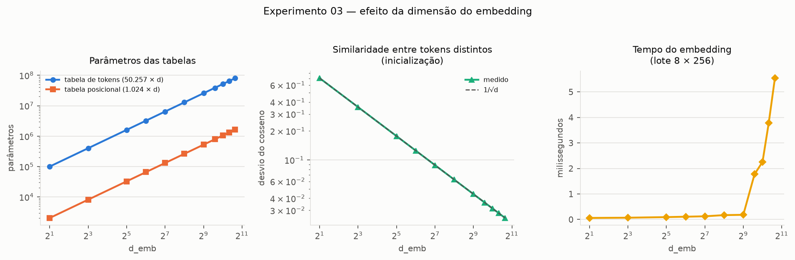
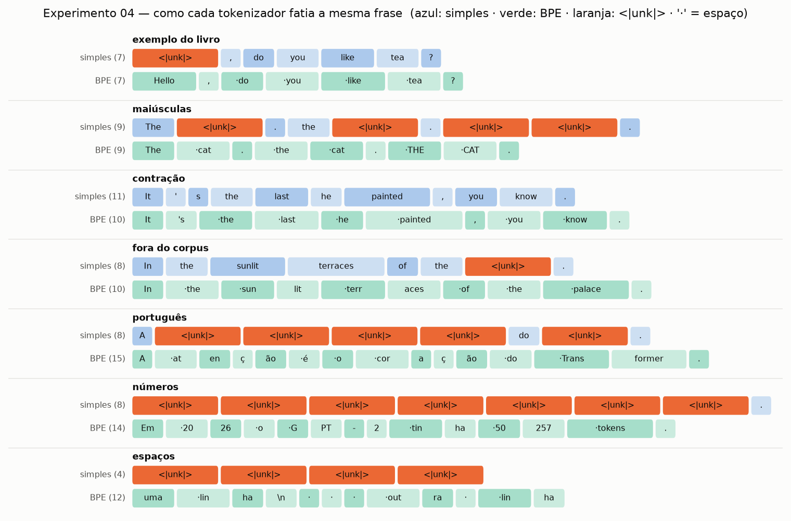
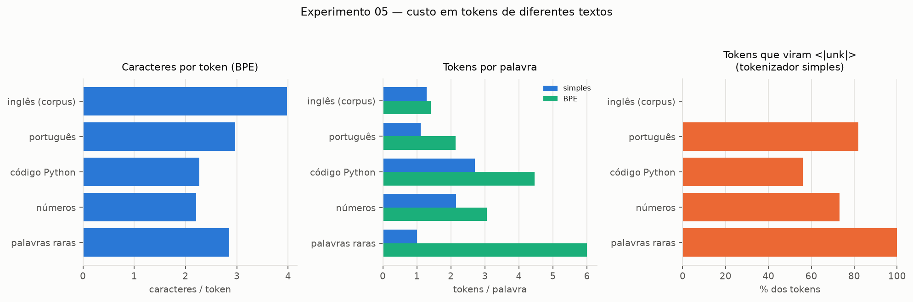
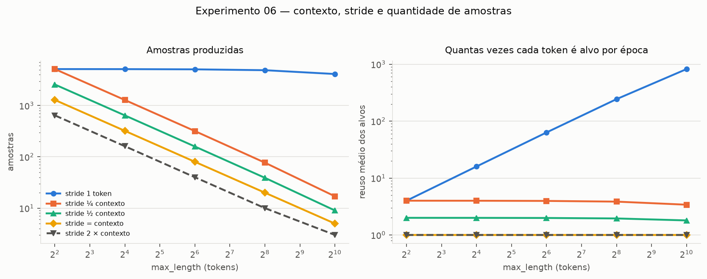
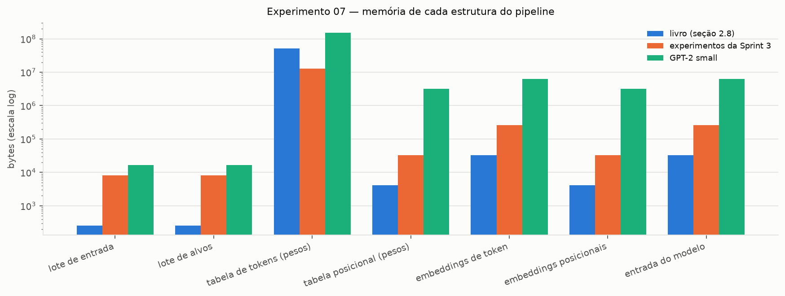
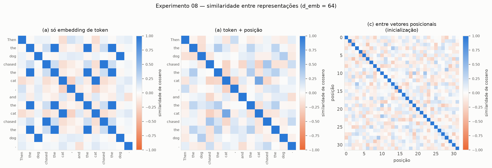

# Sprint 2 — Processamento de Texto: Tokenização, Dados e Embeddings

**Capítulo 2 — *Working with Text Data*** · RASCHKA, S. *Build a Large Language Model (From
Scratch)*, Manning.

---

## 1. Objetivo

Construir a primeira etapa do pipeline do modelo: transformar texto bruto em um tensor numérico que
possa entrar em uma rede neural. A sprint pede que o fluxo inteiro seja implementado e organizado de
forma reaproveitável pelas sprints seguintes:

```
Texto → Tokenização → Tokens → Token IDs → Sequências de treinamento
      → Embeddings → Positional Embeddings → Lote de dados → Entrada do modelo
```

| Etapa pedida | Seção do livro | Implementação |
|---|---|---|
| 3.1 Tokenização | 2.2 | `dividir_em_tokens`, `TokenizadorBPE` em [`src/tokenizacao.py`](../src/tokenizacao.py) |
| 3.2 Vocabulário e Token IDs | 2.3, 2.4, 2.5 | `construir_vocabulario`, `TokenizadorSimples` (com `<\|unk\|>` e `<\|endoftext\|>`) |
| 3.3 Preparação das sequências | 2.6 | `pares_entrada_alvo`, `GPTDatasetV1` em [`src/dados.py`](../src/dados.py) |
| 3.4 Embeddings | 2.7 | `EmbeddingDeEntrada.token_emb` em [`src/embeddings.py`](../src/embeddings.py) |
| 3.5 Positional Embeddings | 2.8 | `EmbeddingDeEntrada.pos_emb` |
| 3.6 Organização dos dados | 2.6 | `criar_dataloader`, `numero_de_amostras` |

---

## 2. Implementação

### 2.1 Organização

| Arquivo | Conteúdo |
|---|---|
| [`src/tokenizacao.py`](../src/tokenizacao.py) | Tokenizador por expressão regular com vocabulário próprio e tokenizador BPE do GPT-2 |
| [`src/dados.py`](../src/dados.py) | Corpus, pares entrada/alvo, `GPTDatasetV1` (janela deslizante) e `DataLoader` |
| [`src/embeddings.py`](../src/embeddings.py) | `EmbeddingDeEntrada`: embedding de token + embedding posicional |
| [`src/validar_dados.py`](../src/validar_dados.py) | 38 verificações contra os valores do livro e contra as propriedades do pipeline |
| [`sprints/Sprint-2.ipynb`](../sprints/Sprint-2.ipynb) | Notebook da leitura: o capítulo passo a passo, com saídas executadas |
| [`experiments/sprint02-texto/`](../experiments/sprint02-texto/) | Os oito experimentos |
| [`technical-glossary/capitulo-02.md`](../technical-glossary/capitulo-02.md) | Glossário do capítulo |
| [`results-by-sprints/sprint02/`](../results-by-sprints/sprint02/) | Figuras, tabelas e log de execução |

### 2.2 Decisão de projeto: uma interface comum para os dois tokenizadores

O capítulo apresenta dois tokenizadores de natureza muito diferente — um didático, por expressão
regular e com vocabulário construído a partir do próprio conto, e o BPE do GPT-2. No código, os dois
expõem a mesma interface:

```python
tokenizador.encode(texto)        -> list[int]
tokenizador.decode(ids)          -> str
tokenizador.tokens_para_ids(...) / ids_para_tokens(...)
tokenizador.tamanho_vocabulario
```

Isso permite que o `GPTDatasetV1` e os experimentos recebam qualquer um deles sem alteração, e torna
a comparação dos experimentos 04 e 05 direta: a única coisa que muda é o objeto passado.

As duas versões do tokenizador simples do livro (`SimpleTokenizerV1` e `V2`) viraram uma única
classe, `TokenizadorSimples`, cujo comportamento diante de uma palavra desconhecida depende do
vocabulário: se ele contém `<|unk|>`, a palavra é mapeada para esse token; se não contém, o `encode`
levanta `KeyError` com mensagem explicativa. A diferença entre V1 e V2 passa a ser uma propriedade
dos dados, e não do código.

### 2.3 Decisões menores

**Corpus local.** O notebook original baixava `the-verdict.txt` do GitHub em quase toda célula. O
arquivo agora fica versionado em `sprints/` e é lido por `carregar_texto()`; nenhum experimento depende
de rede.

**Tokens especiais preservados no `encode`.** `<|endoftext|>` escrito no meio do texto é reconhecido
como um único token antes da expressão regular agir, mesmo sem espaços ao redor.

**Embedding de entrada como `nn.Module`.** Token e posição ficam em uma única camada,
`EmbeddingDeEntrada`, que é exatamente a primeira camada do modelo GPT da Sprint 4. A ordem de criação
das duas tabelas é fixa (token, depois posição) para que uma semente produza sempre os mesmos pesos.

**Integração com a Sprint 3.** O módulo `src/entradas_atencao.py`, que alimenta os experimentos de
atenção, passou a importar estes três módulos em vez de manter cópias próprias do dataset e dos
embeddings. Antes da troca, os tensores que ele produzia foram salvos e, depois, comparados: são
**idênticos bit a bit**, e a validação da Sprint 3 continua com 28/28. Os resultados já publicados da
Sprint 3 continuam válidos.

### 2.4 Verificação numérica

`src/validar_dados.py` executa 38 verificações, e todas passam.

**Uma divergência com o PDF do livro, explicada.** O PDF em `documentation/` é uma edição preliminar.
Nela a expressão regular não separa `:` e `;`, e o conto produz **4.649** tokens e vocabulário de
**1.159** palavras; a edição final, adotada aqui, separa esses dois sinais e obtém **4.690** tokens e
**1.130** palavras. O próprio script reproduz os dois pares de números a partir do mesmo arquivo,
mostrando que a diferença está só na expressão regular. Os valores do BPE, do `DataLoader` e dos
embeddings são iguais nas duas edições. Por isso as verificações citam a seção do livro, e não a
página.

**Contra os valores do livro:**

| Verificação | Seção |
|---|---|
| Tokenização de `"Hello, world. Is this-- a test?"` e 4.690 tokens no conto | 2.2 |
| Vocabulário de 1.130 tokens (1.132 com os especiais, nos IDs 1130 e 1131) | 2.3, 2.4 |
| IDs da frase de Gisburn (listagem 2.3) e da frase com `<\|unk\|>` e `<\|endoftext\|>` (listagem 2.4) | 2.3, 2.4 |
| Vocabulário BPE de 50.257, `<\|endoftext\|>` = 50256, 5.145 tokens no conto | 2.5 |
| IDs BPE da frase de exemplo e da palavra inventada `"Akwirw ier"` (exercício 2.1) | 2.5 |
| Pares `x = [290, 4920, 2241, 287]`, `y = [4920, 2241, 287, 257]` | 2.6 |
| Primeiro e segundo lotes com stride 1; lote de 8 com stride 4 | 2.6 |
| Pesos de `nn.Embedding(6, 3)` com semente 123; forma `(8, 4, 256)` da entrada | 2.7, 2.8 |

**Contra propriedades do pipeline:** `decode` seguido de `encode` recupera os mesmos IDs; o BPE
reconstrói o texto exatamente; o alvo é a entrada deslocada de uma posição; `numero_de_amostras`
coincide com o tamanho real do dataset; `drop_last` descarta o lote incompleto; o embedding é uma
consulta de linhas e equivale a `one-hot @ W`; sem embedding posicional o mesmo token tem o mesmo
vetor em qualquer posição, e com ele não.

```
$ python src/validar_dados.py
38/38 verificações aprovadas
```

---

## 3. Experimentos

Oito experimentos, um por arquivo, em `experiments/sprint02-texto/`. Os sete primeiros correspondem às
sugestões de experimentação da sprint; o oitavo é a demonstração experimental pedida para os
embeddings posicionais. Execução em CPU, `torch 2.13.0`, `tiktoken 0.14.0`, semente 123; o ambiente
completo está em [`results-by-sprints/sprint02/execucao.log`](../results-by-sprints/sprint02/execucao.log).

### Ressalva metodológica

**Nenhuma camada foi treinada.** As medidas sobre embeddings usam pesos aleatórios de inicialização.
Elas caracterizam a *estrutura* do pipeline — formas, memória, quantidade de amostras, o que cada
tokenizador preserva e o que a posição acrescenta —, mas não relações semânticas. Que *"gato"* fique
perto de *"cachorro"* é algo que só o treinamento da Sprint 5 pode produzir.

O corpus é pequeno (20.479 caracteres, 5.145 tokens BPE). Isso é uma limitação para treinar, mas
torna alguns efeitos visíveis que em um corpus grande passariam despercebidos, como o descarte de
dados pelo `drop_last`.

Tempos dependem da máquina e variam entre execuções: devem ser lidos como comparações relativas.

---

## 4. Resultados e análise

### 4.1 Tamanho do contexto (experimento 01)

`max_length` de 4 a 1024, com `stride = max_length`, lote de 8 e `d_emb = 256`.

| `max_length` | Amostras | Amostras (stride 1) | Lotes | Corpus aproveitado | Lote de IDs | Lote de embeddings | Matriz de atenção |
|---:|---:|---:|---:|---:|---:|---:|---:|
| 4 | 1.286 | 5.141 | 160 | 99,5% | 256 B | 32 KiB | 512 B |
| 16 | 321 | 5.129 | 40 | 99,5% | 1 KiB | 128 KiB | 8 KiB |
| 64 | 80 | 5.081 | 10 | 99,5% | 4 KiB | 512 KiB | 128 KiB |
| 128 | 40 | 5.017 | 5 | 99,5% | 8 KiB | 1 MiB | 512 KiB |
| 256 | 20 | 4.889 | 2 | 79,6% | 16 KiB | 2 MiB | 2 MiB |
| 512 | 10 | 4.633 | 1 | 79,6% | 32 KiB | 4 MiB | 8 MiB |
| 1024 | 5 | 4.121 | **0** | **0%** | 64 KiB | 8 MiB | 32 MiB |

**Contexto maior, menos amostras — mas só sem sobreposição.** Com janelas encostadas, dobrar o
contexto divide as amostras pela metade: o corpus é o mesmo, fatiado em pedaços maiores. O total de
previsões por época, porém, quase não muda (5.120 até `max_length = 128`), porque cada amostra de
`L` tokens contém `L` previsões. O contexto maior não traz mais dados — traz *contexto mais longo
para cada previsão*.

**O lote incompleto desperdiça dados em corpus pequenos.** A partir de 256 tokens o número de
amostras deixa de ser múltiplo de 8, e o `drop_last` descarta o resto: 20% do corpus some em 256 e em
512. Em 1024 o corpus produz apenas 5 amostras — menos que um lote — e a época fica **vazia**. Com
este corpus, um GPT-2 de contexto 1024 não pode ser treinado com lote 8.

**Duas curvas de memória.** IDs e embeddings crescem linearmente com o contexto; a matriz de atenção
da Sprint 3 cresce com o quadrado. As curvas se cruzam exatamente em `max_length = 256 = d_emb`:
como os embeddings ocupam `b·L·d` e a matriz `b·L·L`, a atenção passa a dominar a memória assim que o
contexto supera a dimensão do embedding. É a razão de fundo pela qual janelas de contexto longas são
caras.



### 4.2 Tamanho do lote (experimento 02)

`batch_size` de 1 a 64, com `max_length = stride = 64` (80 amostras) e `d_emb = 256`.

| `batch_size` | Lotes por época | Descartadas | Memória do lote | Tempo por amostra (µs) |
|---:|---:|---:|---:|---:|
| 1 | 80 | 0 | 64 KiB | 81,1 |
| 2 | 40 | 0 | 128 KiB | 46,3 |
| 4 | 20 | 0 | 256 KiB | 31,9 |
| 8 | 10 | 0 | 512 KiB | 18,9 |
| 16 | 5 | 0 | 1 MiB | 10,9 |
| 32 | 2 | 16 (20%) | 2 MiB | 7,0 |
| 64 | 1 | 16 (20%) | 4 MiB | 6,3 |

**O lote amortiza o custo fixo.** O tempo por amostra cai 13 vezes de lote 1 para lote 64. Cada
chamada ao `DataLoader` e ao embedding tem um custo fixo — montar o tensor, despachar a operação — que
é dividido entre todas as amostras do lote. O ganho tem retornos decrescentes: de 1 para 16 o tempo
cai 7,4 vezes; de 16 para 64, só 1,7 vezes.

**O lote não muda os dados, só a entrega.** As 80 amostras são as mesmas em todas as configurações. O
que o lote altera é quantas atualizações de pesos haverá por época (80 com lote 1, uma com lote 64) e
quanta memória cada passo exige. Na Sprint 5 esse será um compromisso real: lotes pequenos dão
atualizações mais ruidosas; lotes grandes exigem mais memória e, com este corpus, descartam dados.



### 4.3 Dimensão do embedding (experimento 03)

`d_emb` de 2 a 1600, com o vocabulário do GPT-2 e `context_length = 1024`.

| `d_emb` | Parâmetros (tokens) | Memória das tabelas | Norma média | Desvio do cosseno | Maior \|cosseno\| | Tempo (ms) |
|---:|---:|---:|---:|---:|---:|---:|
| 2 | 100.514 | 0,4 MiB | 1,28 | 0,707 | 1,000 | 0,06 |
| 64 | 3.216.448 | 12,5 MiB | 7,95 | 0,125 | 0,585 | 0,11 |
| 256 | 12.865.792 | 50,1 MiB | 15,98 | 0,062 | 0,297 | 0,17 |
| 768 (GPT-2 small) | 38.597.376 | 150,2 MiB | 27,73 | 0,036 | 0,183 | 1,77 |
| 1600 (GPT-2 XL) | 80.411.200 | 313,0 MiB | 40,00 | 0,025 | 0,137 | 5,54 |

**A tabela de tokens é grande.** Com `d_emb = 768` ela tem 38,6 milhões de parâmetros — cerca de 31%
dos 124 milhões do GPT-2 small, antes de qualquer camada de atenção. A tabela posicional é 49 vezes
menor (1.024 linhas contra 50.257), e o custo do vocabulário é o que domina.

**Dimensão maior dá mais "espaço".** Com pesos aleatórios, o desvio da similaridade de cosseno entre
tokens distintos segue `1/√d` com precisão (0,707 em `d = 2`, 0,025 em `d = 1600`). Em 2 dimensões,
entre 2.000 tokens sorteados sempre há pares praticamente colineares (cosseno 1,0): não há direções
suficientes para todos. Em 1600 dimensões o par mais parecido tem cosseno 0,14 — todos os vetores
são quase ortogonais. A dimensão define quantas "direções independentes" o treinamento terá à
disposição para separar significados.

**A norma cresce com `√d`.** A inicialização `N(0, 1)` produz vetores de norma `≈ √d` (27,7 para
`d = 768`). Valores crescendo com a dimensão são um dos motivos para a *layer normalization* que
aparecerá na Sprint 4.

**O tempo tem um salto.** Até 512 o custo do embedding é quase constante (0,06 a 0,18 ms) e salta 10
vezes em 768. A saída `(8, 256, 768)` ocupa 6 MiB; a hipótese mais provável é que ela deixe de caber
na memória cache do processador, mas o experimento não isola esse efeito.



### 4.4 Diferentes sequências de entrada (experimento 04)

Sete frases, tokenizadas pelo tokenizador simples (vocabulário do conto, 1.132 tokens) e pelo BPE do
GPT-2 (50.257 tokens).

| Sequência | Tokens (simples) | `<\|unk\|>` | Reconstrói? | Tokens (BPE) | Reconstrói? |
|---|---:|---:|:---:|---:|:---:|
| exemplo do livro | 7 | 1 | não | 7 | sim |
| maiúsculas | 9 | 4 | não | 9 | sim |
| contração | 11 | 0 | não | 10 | sim |
| fora do corpus | 8 | 1 | não | 10 | sim |
| português | 8 | 5 | não | 15 | sim |
| números | 8 | 7 | não | 14 | sim |
| espaços | 4 | 4 | não | 12 | sim |



**O tokenizador simples perde informação de duas formas.** A primeira é o `<|unk|>`: qualquer palavra
fora do conto — *Hello*, *palace*, *cat*, *THE*, números, todo o português — vira o mesmo token, e a
distinção entre elas desaparece. A segunda é mais sutil: **nenhuma** das sete frases é reconstruída
exatamente, nem a contração, que não tem nenhuma palavra desconhecida. O `decode` devolve
`"It' s the last..."`, porque os espaços foram descartados na tokenização e precisam ser adivinhados
na volta.

**O BPE reconstrói tudo.** As sete frases voltam idênticas, inclusive a quebra de linha e os espaços
de indentação, que viram tokens próprios. Palavras raras são quebradas em pedaços que existem no
vocabulário: *palace* inteiro, mas *sunlit* → `sun` + `lit`, *atenção* → `at` + `en` + `ç` + `ão`.

**A grafia muda o token.** No BPE, `the`, ` the`, `The`, ` The` e `THE` têm IDs diferentes (1169,
262, 464, 383, 10970). O espaço inicial faz parte do token. Para o modelo, essas cinco formas
começam como vetores sem relação nenhuma; que elas significam a mesma coisa terá de ser aprendido.

### 4.5 Quantidade de tokens para diferentes textos (experimento 05)

| Texto | Caracteres | Tokens BPE | Caracteres por token | Tokens BPE por palavra | `<\|unk\|>` (simples) | Caracteres em 1024 tokens |
|---|---:|---:|---:|---:|---:|---:|
| inglês (corpus) | 20.479 | 5.145 | 3,98 | 1,42 | 0% | 4.076 |
| português | 475 | 160 | 2,97 | 2,13 | 82% | 3.040 |
| código Python | 375 | 165 | 2,27 | 4,46 | 56% | 2.327 |
| números | 128 | 58 | 2,21 | 3,05 | 73% | 2.260 |
| palavras raras | 137 | 48 | 2,85 | 6,00 | 100% | 2.923 |

**O custo de um texto depende do idioma.** O BPE do GPT-2 foi treinado majoritariamente em inglês, e
isso aparece: em inglês cada token carrega quase 4 caracteres; em português, 3. Uma palavra em
português custa em média 50% mais tokens (2,13 contra 1,42). Na prática, uma janela de 1024 tokens
comporta 25% menos texto em português do que em inglês, e o mesmo conteúdo custa mais processamento.

**Código e números são os mais caros por caractere.** Os espaços de indentação e os símbolos do código
viram muitos tokens curtos (2,3 caracteres por token); números longos são quebrados em pedaços
arbitrários (`50257` → `50` + `257`), o que ajuda a explicar por que modelos de linguagem têm
dificuldade com aritmética.

**Os dois tokenizadores falham em direções opostas.** O simples mantém sempre um token por palavra,
mas perde a palavra (100% de `<|unk|>` nas palavras raras). O BPE nunca perde nada, mas paga com mais
tokens (6 por palavra rara).



### 4.6 Contexto e quantidade de amostras (experimento 06)

Contextos de 4 a 1024 combinados com cinco valores de `stride`. Em todas as 25 configurações, a
fórmula `ceil((N − max_length) / stride)` coincide com o tamanho real do dataset.

| `max_length` | `stride` | Amostras | Sobreposição | Vezes que cada token é alvo | Tokens nunca usados como alvo |
|---:|---:|---:|---:|---:|---:|
| 64 | 1 | 5.081 | 98,4% | 63,2 | 0% |
| 64 | 16 | 318 | 75% | 4,0 | 0,2% |
| 64 | 32 | 159 | 50% | 2,0 | 0,5% |
| 64 | 64 | 80 | 0% | 1,0 | 0,5% |
| 64 | 128 | 40 | 0% | 1,0 | 50,2% |
| 1024 | 1 | 4.121 | 99,9% | 820,4 | 0% |
| 1024 | 1024 | 5 | 0% | 1,0 | 0,5% |

**Quem decide o número de amostras é o `stride`.** Com `stride = 1`, o número de amostras quase não
depende do contexto (`≈ N − max_length`: 5.141 com contexto 4, 4.121 com 1024). Com `stride` igual
ao contexto, ele cai para `≈ N / max_length`.

**Mais amostras não é mais informação.** Com `stride = 1` e contexto 1024 há 4.121 amostras, mas cada
uma repete 99,9% da anterior, e cada token aparece como alvo 820 vezes por época. O modelo veria os
mesmos 5.145 tokens centenas de vezes — o cenário clássico de sobreajuste, que o livro cita ao
justificar `stride = max_length`. No outro extremo, `stride` maior que o contexto pula trechos: com o
dobro do contexto, metade dos tokens nunca é alvo.

**O ponto equilibrado é `stride = max_length`:** cada token é previsto exatamente uma vez por época,
sem lacunas (os 0,5% restantes são o fim do corpus, que não completa uma janela).



### 4.7 Dimensões das estruturas do pipeline (experimento 07)

O pipeline executado de ponta a ponta em três configurações. Para o GPT-2 small:

| Etapa | Forma | Tipo | Memória |
|---|---|---|---:|
| texto bruto | 20.479 caracteres | `str` | 20 KB |
| tokens | 5.145 pedaços | `list[str]` | 20 KB |
| token IDs | 5.145 inteiros | `list[int]` | 185 KB |
| amostras (entradas + alvos) | 5 × 2 × (1024,) | `int64` | 82 KB |
| lote de entrada | (2, 1024) | `int64` | 16 KB |
| tabela de tokens | (50257, 768) | `float32` | **154 MB** |
| tabela posicional | (1024, 768) | `float32` | 3,1 MB |
| embeddings de token | (2, 1024, 768) | `float32` | 6,3 MB |
| embeddings posicionais | (1024, 768) | `float32` | 3,1 MB |
| entrada do modelo | (2, 1024, 768) | `float32` | 6,3 MB |

As três configurações completas estão em
[`exp07-dimensoes-do-pipeline.csv`](../results-by-sprints/sprint02/exp07-dimensoes-do-pipeline.csv).

**A tokenização BPE não perde nem acrescenta nada.** A soma dos bytes dos 5.145 pedaços é exatamente
o tamanho do texto, 20.479 bytes: o BPE só fatia.

**A maior expansão é de ID para vetor.** Cada ID `int64` ocupa 8 bytes; seu embedding ocupa
`4 · d_emb` bytes. A memória é multiplicada por `d_emb / 2`: 128 vezes no exemplo do livro
(256 B → 32 KiB) e 384 vezes no GPT-2 small (16 KiB → 6 MiB).

**A estrutura dominante não é um dado, é um parâmetro.** Em todas as configurações a maior estrutura
é a tabela de embedding de tokens (51 MB no livro, 154 MB no GPT-2 small) — centenas de vezes maior
que o lote que passa por ela. Ela existe uma vez e serve a todos os lotes.

**Listas Python são caras.** Os 5.145 IDs ocupam 185 KB como `list[int]` e 41 KB como tensor
`int64`: cada inteiro Python carrega um objeto completo. É uma das razões para o dataset converter as
janelas em tensores logo na construção.



### 4.8 Por que a posição precisa ser representada (experimento 08)

| Medida | Sem posição | Com posição |
|---|---:|---:|
| Cosseno entre as ocorrências do mesmo token (frase com 4 × `" the"`) | **1,000** | 0,367 |
| Distância entre o vetor de `" dog"` em *"the dog bit the man"* e em *"the man bit the dog"* | **0,00** | 12,25 |
| As duas frases formam o mesmo conjunto de vetores? | **sim** | não |
| Diferença entre as *médias* dos vetores das duas frases | 0,00 | **0,00** |



**Sem posição, a ordem não existe.** O embedding de token é uma consulta de tabela: o mesmo ID devolve
o mesmo vetor, em qualquer lugar da frase. No mapa da esquerda, as quatro ocorrências de `" the"` têm
similaridade exatamente 1 entre si, e *"the dog bit the man"* e *"the man bit the dog"* produzem
exatamente o mesmo conjunto de vetores — só em outra ordem. Como a atenção da Sprint 3 também é cega à
ordem (experimento 08 da Sprint 3), as duas frases seriam indistinguíveis para o modelo inteiro.

**Com posição, cada ocorrência é única.** Somar o vetor da posição faz a similaridade entre as
ocorrências de `" the"` cair de 1 para 0,37, e `" dog"` na posição 1 passa a ser outro vetor que
`" dog"` na posição 4. Na inicialização, a posição pesa tanto quanto a identidade do token: as duas
normas são parecidas (7,7 e 8,4, ambas próximas de `√64 = 8`).

**Uma ressalva que o experimento revelou.** A *média* dos vetores das duas frases continua igual
mesmo com posição. A soma é linear: a média de `token + posição` é a média dos tokens mais a média das
posições, e as duas frases têm os mesmos tokens e as mesmas posições. O embedding posicional só é
aproveitado por operações que combinam token e posição de forma **não linear** — como o softmax da
atenção. Ele não resolve a ordem sozinho; ele fornece a informação que a atenção usa.

**A posição ainda não significa proximidade.** No mapa da direita, a similaridade entre posições
vizinhas (−0,03) é igual à entre posições distantes (−0,01): na inicialização, a posição 3 é tão
diferente da 4 quanto da 30. Os vetores posicionais do GPT-2 são *aprendidos*, e a noção de que
posições próximas se relacionam terá de surgir no treinamento.

---

## 5. Respostas às perguntas da sprint

**1. Por que um LLM não pode trabalhar diretamente com o texto bruto?**
Uma rede neural só executa operações numéricas — multiplicações de matrizes, somas, funções de
ativação. O texto precisa virar números, e números com uma estrutura fixa: o modelo recebe tensores
de forma `(b, L, d)`. A tokenização define as unidades, o vocabulário as numera e o embedding as
transforma em vetores. O experimento 07 mostra essa transformação etapa por etapa.

**2. Qual é a função do vocabulário?**
É o dicionário que fixa a correspondência entre cada token e um inteiro, nos dois sentidos: `encode`
consulta `token → ID` e `decode` consulta `ID → token`. Ele também define o que o modelo consegue
representar. O experimento 04 mostra o custo de um vocabulário pequeno e fechado: 1.132 tokens do
conto não cobrem *Hello*, *palace* nem o português, e tudo isso vira `<|unk|>`. O vocabulário define
ainda o tamanho da tabela de embedding e da camada de saída (50.257 linhas no GPT-2).

**3. Qual é a diferença entre um token e um Token ID?**
O token é o pedaço de texto (`" the"`); o Token ID é o seu índice no vocabulário (262). O token
depende do tokenizador — `" the"` e `"the"` são tokens diferentes no BPE, com IDs 262 e 1169 —, e o ID
depende do vocabulário: o mesmo `"the"` é 988 no vocabulário do conto e 1169 no do GPT-2.

**4. Por que os Token IDs não são utilizados diretamente como representação semântica?**
Porque são apenas posições em uma lista. A ordem do vocabulário simples é alfabética e a do BPE vem da
ordem das fusões; em nenhum dos casos IDs próximos têm significados próximos, e operações aritméticas
sobre eles (`262 + 1`, `262 × 2`) não têm sentido. Além disso, um único número não comporta as várias
dimensões de significado de uma palavra. O embedding substitui o índice por um vetor treinável em que
a geometria — distância, direção — pode codificar semelhança.

**5. Qual é a função dos embeddings?**
Transformar cada ID em um vetor denso de `d_emb` números reais por meio de uma consulta de tabela
(verificado: `nn.Embedding` equivale a `one-hot @ W`). Os vetores começam aleatórios e são ajustados
no treinamento. O experimento 03 mostra que a dimensão determina a capacidade dessa representação: com
`d = 2` há tokens praticamente colineares; com `d = 1600` todos os 2.000 tokens sorteados são quase
ortogonais.

**6. Por que é necessário representar a posição dos tokens?**
Porque o embedding de token não depende da posição e a atenção não percebe a ordem. O experimento 08
mostra que, sem posição, *"the dog bit the man"* e *"the man bit the dog"* produzem o mesmo conjunto de
vetores, e o experimento 08 da Sprint 3 mostra que a atenção, sem posição, distribui os pesos de forma
uniforme sobre tokens repetidos. O embedding posicional torna a representação dependente de onde o
token está.

**7. Qual é a relação entre tamanho do contexto e quantidade de amostras de treinamento?**
É dada por `amostras = ceil((N − max_length) / stride)`, conferida em 25 configurações no experimento
06. Com `stride = max_length`, as amostras são inversamente proporcionais ao contexto (1.286 com 4
tokens, 5 com 1024), mas o total de previsões por época se mantém. Com `stride = 1`, as amostras quase
não diminuem, ao custo de repetir os mesmos alvos `max_length` vezes. Em corpus pequenos o contexto
longo tem um limite duro: com 1024 tokens e lote 8, este corpus não enche nenhum lote (experimento 01).

**8. Qual é o impacto da dimensão do embedding sobre as estruturas utilizadas pelo modelo?**
A dimensão multiplica tudo o que vem depois do embedding. A tabela de tokens cresce `50.257 × d`
(38,6 milhões de parâmetros em `d = 768`); o tensor de entrada `(b, L, d)` e todas as ativações das
camadas seguintes crescem com ela; a memória de cada lote é multiplicada por `d / 2` em relação aos IDs
(experimentos 03 e 07). Em troca, a dimensão maior oferece mais direções independentes para separar
significados. A matriz de atenção é uma exceção: depende de `L²`, não de `d` (experimento 01).

**9. Qual é a função do DataLoader no pipeline?**
Entregar os dados ao modelo na forma que o treinamento precisa: agrupar as amostras do `Dataset` em
tensores `(batch_size, max_length)`, embaralhar a ordem a cada época (`shuffle`) e descartar o lote
incompleto (`drop_last`). O experimento 02 mostra os dois lados: o lote reduz o tempo por amostra em 13
vezes, e o `drop_last` pode descartar 20% de um corpus pequeno. O `Dataset` decide *quais* amostras
existem; o `DataLoader` decide *como* elas chegam.

**10. Quais informações produzidas nesta Sprint serão utilizadas pelo mecanismo de atenção da Sprint
seguinte?**
O tensor de embeddings de entrada `(b, num_tokens, d_emb)` — soma dos embeddings de token e
posicionais —, que é exatamente o `x` recebido por todas as classes de `src/attention.py`. Indiretamente,
também o `max_length`, que vira o `context_length` da máscara causal, e os alvos `(b, num_tokens)`,
que serão usados na função de perda da Sprint 5. Essa ligação já está em funcionamento:
`src/entradas_atencao.py` encadeia `tokenizacao.py`, `dados.py` e `embeddings.py` para alimentar os
experimentos da Sprint 3.

---

## 6. Síntese

1. **O tokenizador decide o que o modelo pode ver.** O tokenizador simples perde toda palavra fora do
   conto e nunca reconstrói o texto exatamente; o BPE reconstrói tudo, ao custo de mais tokens para o
   que é raro.
2. **O custo em tokens depende do idioma.** O português custa 50% mais tokens por palavra que o inglês
   no BPE do GPT-2; uma janela de 1024 tokens comporta 25% menos texto.
3. **O `stride`, e não o contexto, controla a quantidade de amostras** — e amostras sobrepostas
   repetem informação em vez de acrescentá-la.
4. **A maior estrutura da entrada é a tabela de embedding de tokens**, e a passagem de ID para vetor é
   a maior expansão de memória do pipeline (`× d_emb / 2`).
5. **Sem embedding posicional, a ordem não existe** — e mesmo com ele a ordem só é aproveitada por
   operações não lineares como a atenção.

---

## 7. Limitações e próximos passos

**Limitações.**

- Nenhuma camada foi treinada. As medidas sobre embeddings descrevem a inicialização, não relações
  aprendidas.
- O corpus tem 5.145 tokens BPE. Os efeitos de `drop_last` e de contexto longo observados aqui seriam
  irrelevantes em um corpus real, de bilhões de tokens.
- O BPE foi usado como biblioteca (`tiktoken`); o algoritmo de treinamento do vocabulário — as fusões
  sucessivas de pares frequentes — não foi implementado, o que está fora do escopo do capítulo.
- Os tempos são de CPU, de uma única máquina, e variam entre execuções.

**Próximos passos.** `EmbeddingDeEntrada` é a primeira camada do modelo GPT da Sprint 4, que
acrescentará *dropout* sobre a soma dos embeddings. Os alvos produzidos pelo `GPTDatasetV1`, ainda não
usados, entram na função de perda da Sprint 5.

---

## 8. Entregáveis da Sprint 2

| Entregável | Onde |
|---|---|
| Glossário atualizado do Capítulo 2 | [`technical-glossary/capitulo-02.md`](../technical-glossary/capitulo-02.md) |
| Código de tokenização | `dividir_em_tokens`, `TokenizadorBPE` em [`src/tokenizacao.py`](../src/tokenizacao.py) |
| Vocabulário e Token IDs | `construir_vocabulario`, `TokenizadorSimples` |
| Preparação das sequências de treinamento | `pares_entrada_alvo`, `GPTDatasetV1` em [`src/dados.py`](../src/dados.py) |
| Embeddings | `EmbeddingDeEntrada.token_emb` em [`src/embeddings.py`](../src/embeddings.py) |
| Positional Embeddings | `EmbeddingDeEntrada.pos_emb` |
| Estrutura de carregamento dos dados | `criar_dataloader` |
| Experimentos realizados | [`experiments/sprint02-texto/`](../experiments/sprint02-texto/) |
| Análise dos resultados | este relatório |
| Código organizado no repositório | `src/`, `sprints/Sprint-2.ipynb`, `experiments/`, `results-by-sprints/` |

```bash
python src/validar_dados.py                          # 38 verificações contra o livro
cd experiments/sprint02-texto && python executar_todos.py
```

---

## Referência

RASCHKA, Sebastian. **Build a Large Language Model (From Scratch)**. Manning Publications.
Capítulo 2 — *Working with Text Data*.
