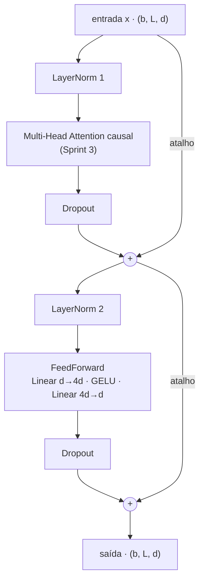
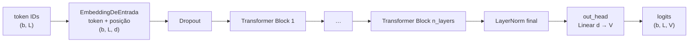
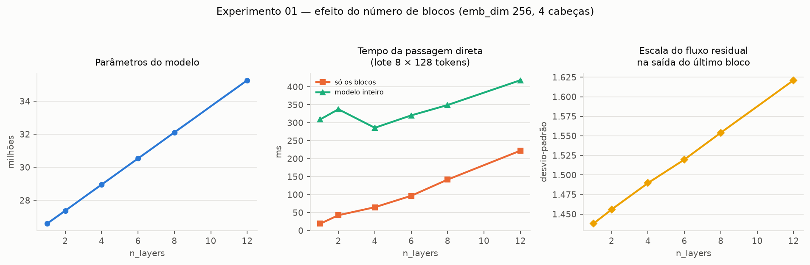
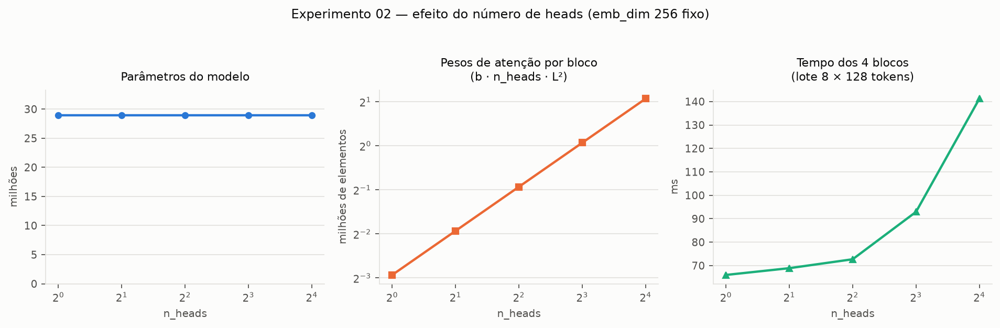
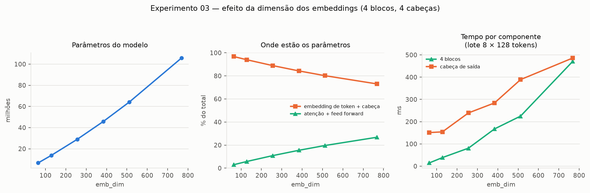
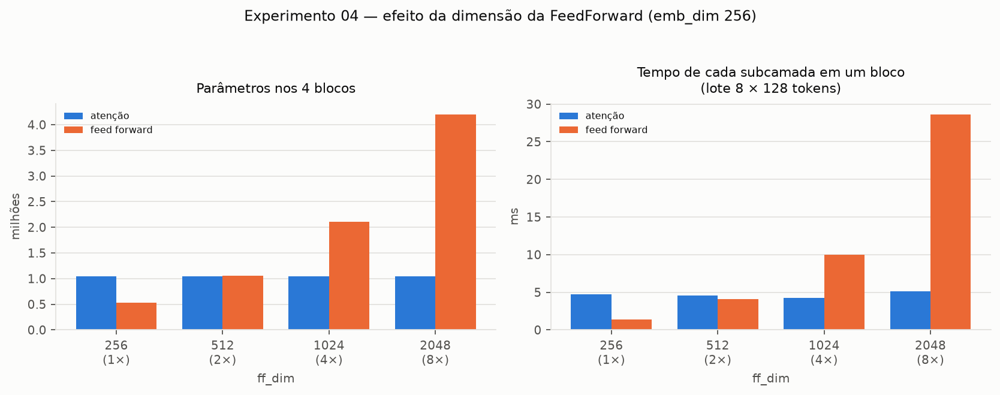
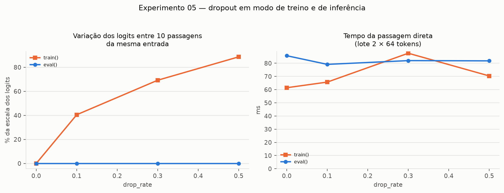
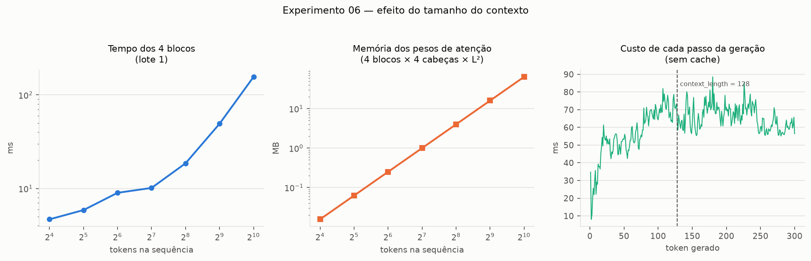
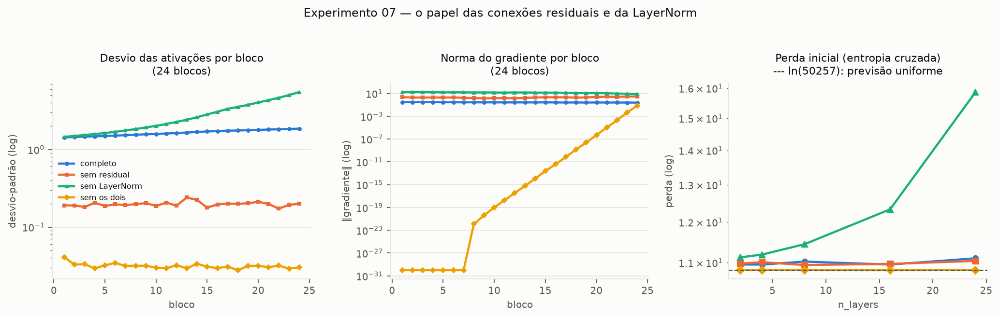
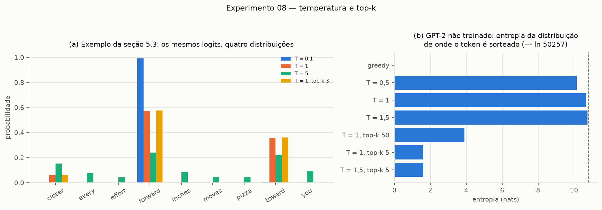

# Sprint 4 — Arquitetura GPT: do Transformer Block à Geração de Texto

**Capítulo 4 — *Implementing a GPT model from scratch to generate text*** e **seção 5.3 — *Decoding
strategies to control randomness*** · RASCHKA, S. *Build a Large Language Model (From Scratch)*, Manning.

---

## 1. Objetivo

Integrar a atenção da Sprint 3 aos demais componentes do Transformer e chegar a um modelo GPT capaz de
receber uma sequência de Token IDs, produzir logits para o vocabulário e gerar texto de forma
autorregressiva. As instruções da sprint estão em
[`documentation/instrucoes-sprints/sprint-04-arquitetura-gpt.txt`](../documentation/instrucoes-sprints/sprint-04-arquitetura-gpt.txt).

| Entregável | Onde |
|---|---|
| 1. Glossário do Capítulo 4 | [`technical-glossary/capitulo-04.md`](../technical-glossary/capitulo-04.md) |
| 2. Transformer Block | `LayerNorm`, `GELU`, `FeedForward`, `TransformerBlock` em [`src/gpt.py`](../src/gpt.py) — seção 2.2 |
| 3. Modelo GPT | `GPTModel` em [`src/gpt.py`](../src/gpt.py) — seção 2.3 |
| 4. Inferência e geração | [`src/geracao.py`](../src/geracao.py) — seção 2.4 |
| 5. Experimentação e análise | [`experiments/sprint04-gpt/`](../experiments/sprint04-gpt/) — seções 3 e 4 |

---

## 2. Implementação

### 2.1 Organização

| Arquivo | Conteúdo |
|---|---|
| [`src/gpt.py`](../src/gpt.py) | Configurações do GPT-2, `LayerNorm`, `GELU`, `FeedForward`, `TransformerBlock`, `GPTModel`, contagem de parâmetros e memória |
| [`src/geracao.py`](../src/geracao.py) | Conversão texto ↔ IDs, seleção do próximo token (greedy, temperatura, top-k) e geração autorregressiva |
| [`src/validar_gpt.py`](../src/validar_gpt.py) | 38 verificações contra os valores do livro e contra as propriedades dos componentes |
| [`notebook/sprint04-arquitetura-gpt.ipynb`](../notebook/sprint04-arquitetura-gpt.ipynb) | Do LayerNorm à geração, passo a passo, com as formas de cada tensor |
| [`experiments/sprint04-gpt/`](../experiments/sprint04-gpt/) | Os oito experimentos |
| [`results-by-sprints/sprint04/`](../results-by-sprints/sprint04/) | Figuras, tabelas e log de execução |

O modelo **reaproveita** as sprints anteriores em vez de reescrevê-las: a camada de entrada é a
`EmbeddingDeEntrada` da Sprint 2 (`src/embeddings.py`) e a atenção de cada bloco é a
`MultiHeadAttention` da Sprint 3 (`src/attention.py`), sem nenhuma alteração.

### 2.2 O Transformer Block (Entregável 2)



O bloco tem duas subcamadas com a mesma estrutura: **normaliza, transforma, aplica dropout e soma a
entrada de volta**. A primeira mistura informação *entre* tokens (atenção); a segunda transforma *cada*
token isoladamente (feed forward).

| Componente | Função no bloco |
|---|---|
| **LayerNorm** | Leva cada vetor de token a média 0 e variância 1 antes de cada subcamada, com `scale` e `shift` treináveis para desfazer a normalização se for útil. Mantém a escala das ativações estável ao longo da pilha de blocos (experimento 07). É aplicada *antes* da subcamada (*pre-LayerNorm*), como no GPT-2. |
| **Multi-Head Attention** | Cada token reúne informação dos tokens anteriores e de si mesmo, com a máscara causal impedindo o acesso ao futuro. É o único ponto do modelo em que as posições se comunicam. |
| **FeedForward + GELU** | Duas camadas lineares com uma não linearidade no meio, aplicadas a cada posição. Expande o vetor para `4d` dimensões, onde a GELU combina as características que a atenção reuniu, e comprime de volta para `d`. Concentra dois terços dos parâmetros do bloco. |
| **Dropout** | Zera aleatoriamente uma fração das ativações, só durante o treino, antes de cada soma residual (e, dentro da atenção, sobre os pesos de atenção). |
| **Conexões residuais** | Somam a entrada de cada subcamada à sua saída. Criam um caminho direto para o gradiente e fazem cada subcamada aprender uma *correção* sobre a representação recebida, em vez de reconstruí-la. |

**Dimensões dos tensores**, para o GPT-2 small (`d = 768`, 12 cabeças, `head_dim = 64`) e um lote de
2 sequências de 4 tokens, como no livro:

| Etapa | Forma | Observação |
|---|---|---|
| entrada `x` | `(2, 4, 768)` | um vetor de 768 números por token |
| `norm1(x)` | `(2, 4, 768)` | mesma forma; média 0 e variância 1 por token |
| Q, K, V (antes de dividir) | `(2, 4, 768)` cada | projeções `768 × 768` |
| Q, K, V por cabeça | `(2, 12, 4, 64)` | 12 cabeças de 64 dimensões |
| pesos de atenção | `(2, 12, 4, 4)` | um mapa `L × L` por cabeça; triangular (máscara causal) |
| contexto reagrupado + `out_proj` | `(2, 4, 768)` | as 12 cabeças lado a lado, misturadas pela projeção de saída |
| `+ x` (residual) | `(2, 4, 768)` | — |
| `ff`: camada de expansão | `(2, 4, 3072)` | `Linear 768 → 3.072` + GELU |
| `ff`: camada de compressão | `(2, 4, 768)` | `Linear 3.072 → 768` |
| `+ atalho` (saída do bloco) | `(2, 4, 768)` | **igual à forma de entrada** — é o que permite empilhar blocos |

**Parâmetros por bloco** (GPT-2 small): atenção 2.360.064, feed forward 4.722.432, duas LayerNorm
3.072 — total **7.085.568**. A feed forward tem o dobro de parâmetros da atenção (exercício 4.1).

**Chaves experimentais.** `usar_residual` e `usar_layernorm`, lidas da configuração (padrão `True`),
desligam cada mecanismo. Não fazem parte do GPT; existem para que o experimento 07 meça a contribuição
de cada um para a estabilidade.

### 2.3 O modelo GPT (Entregável 3)



No código (`GPTModel` em `src/gpt.py`), os componentes aparecem como atributos com o nome do papel que
cumprem, na ordem em que a sequência os atravessa:

| Atributo | Componente | Forma da saída | Como participa do processamento |
|---|---|---|---|
| `embedding` | `EmbeddingDeEntrada` (Sprint 2) | `(b, L, d)` | troca cada ID por um vetor e soma o vetor da posição |
| `drop_emb` | `nn.Dropout` | `(b, L, d)` | regularização da entrada, só no treino |
| `trf_blocks` | `n_layers` × `TransformerBlock` | `(b, L, d)` | refinam a representação de cada token com o contexto anterior |
| `final_norm` | `LayerNorm` | `(b, L, d)` | normaliza a saída do último bloco antes da projeção |
| `out_head` | `Linear(d, V)` sem bias | `(b, L, V)` | *language model head*: uma pontuação por token do vocabulário |

O resultado são **logits**: para cada uma das `L` posições, `V = 50.257` pontuações para o token que
viria *depois* daquela posição. Não são probabilidades — o softmax fica para a geração e, na Sprint 5,
para a função de perda.

**Distribuição dos parâmetros** do GPT-2 small (`parametros_por_componente`):

| Componente | Parâmetros | % |
|---|---:|---:|
| embedding de token `(50.257 × 768)` | 38.597.376 | 23,7% |
| embedding posicional `(1.024 × 768)` | 786.432 | 0,5% |
| atenção (12 blocos) | 28.320.768 | 17,4% |
| feed forward (12 blocos) | 56.669.184 | 34,8% |
| LayerNorm (24 nos blocos + final) | 38.400 | 0,02% |
| cabeça de saída `(768 × 50.257)` | 38.597.376 | 23,7% |
| **total** | **163.009.536** | 621,83 MB em float32 |

**Por que o GPT-2 é chamado de "124M".** A cabeça de saída tem a mesma forma da tabela de tokens, e o
GPT-2 original usa uma única matriz para as duas (*weight tying*). Descontando a cabeça, o total é
**124.412.160**. O livro, e este projeto por padrão, mantêm as duas separadas; a chave
`compartilhar_pesos=True` ativa o compartilhamento.

**Reprodutibilidade com o livro.** Como a ordem de criação dos submódulos é a mesma do livro —
inclusive dentro da `MultiHeadAttention` da Sprint 3 e da `EmbeddingDeEntrada` da Sprint 2 —, a semente
123 produz exatamente os mesmos pesos. Os logits do lote de exemplo e o texto gerado coincidem com os
publicados (seção 2.5).

### 2.4 Inferência e geração autorregressiva (Entregável 4)

O modelo não gera texto: ele só pontua o próximo token. A geração é um laço em volta dessa operação
(`gerar` em `src/geracao.py`):

```
ids = texto_para_ids("Hello, I am")                      # (1, 4)
repetir max_novos_tokens vezes:
    contexto = ids[:, -context_length:]                   # 1. corta o contexto ao tamanho aceito
    logits   = modelo(contexto)                           # 2. (1, L, 50257)
    logits   = logits[:, -1, :]                           # 3. só a última posição: (1, 50257)
    proximo  = selecionar_proximo_token(logits, T, top_k) # 4. (1, 1)
    ids      = concatenar(ids, proximo)                   # 5. o token gerado vira contexto
```

**Relação entre logits, probabilidades, seleção e geração autorregressiva:**

1. **Logits.** O modelo devolve pontuações reais, sem escala definida. Só os da última posição
   interessam: eles condicionam a previsão a todo o texto, porque a atenção causal deixa a última
   posição ver todas as anteriores.
2. **Probabilidades.** O softmax, `p_i = exp(z_i) / Σ_j exp(z_j)`, transforma os logits em uma
   distribuição — valores positivos que somam 1 — **preservando a ordem**: o maior logit é sempre a
   maior probabilidade.
3. **Seleção.** Uma regra escolhe um token a partir da distribuição:
   - **greedy** (`temperatura = 0`): o `argmax`. Como o softmax preserva a ordem, nem é preciso
     calculá-lo. É determinístico: o mesmo contexto gera sempre o mesmo texto.
   - **amostragem** (`temperatura > 0`): sorteio proporcional a `softmax(logits / T)`. `T < 1` acentua
     as diferenças entre os logits (escolhas mais previsíveis); `T > 1` as atenua (mais variadas).
   - **top-k**: antes do softmax, os logits fora dos `k` maiores viram `−∞`, e a probabilidade desses
     tokens passa a ser exatamente zero. Impede que o sorteio busque tokens muito improváveis.
4. **Geração autorregressiva.** O token escolhido é anexado ao contexto e o modelo é executado de novo.
   Cada token depende de todos os anteriores, inclusive dos que o próprio modelo gerou.

**Um passo concreto.** Com o GPT-2 small (semente 123) e o contexto *"Hello, I am"*, os logits da
última posição têm desvio-padrão de apenas 0,58. Depois do softmax, o token mais provável, `" Feature"`
(ID 27018), recebe probabilidade 0,000205 — cerca de 10 vezes a de uma escolha uniforme (1/50.257 =
0,0000199). A escolha greedy o seleciona; repetindo o laço seis vezes, o modelo produz
*"Hello, I am Featureiman Byeswickattribute argue"*, exatamente como no livro.

**Dois cuidados implementados.**
- **Modo de avaliação.** `gerar` emite um aviso se o modelo estiver em `train()`: com o dropout ativo, a
  mesma entrada produz saídas diferentes a cada passagem (experimento 05).
- **Truncamento do contexto.** Antes de cada passo, o contexto é cortado aos últimos `context_length`
  tokens, pois a tabela posicional não tem vetores além disso. Os tokens mais antigos deixam de
  influenciar a previsão.

**Custo.** A implementação não guarda nada entre passos: a cada token novo, o contexto inteiro é
reprocessado. O custo de cada passo cresce com o contexto até `context_length` e então se estabiliza
(experimento 06). Modelos em produção evitam esse recálculo guardando as chaves e valores dos passos
anteriores (*KV cache*), o que fica fora do escopo do livro.

### 2.5 Verificação numérica

`src/validar_gpt.py` executa **38 verificações**, e todas passam. Como nas sprints anteriores, citam a
seção, e não a página, porque o PDF do projeto é uma edição preliminar.

| Verificação | Seção |
|---|---|
| Saída da camada de exemplo, médias e variâncias antes da normalização; LayerNorm com média 0 e variância 1; igual a `torch.nn.LayerNorm` | 4.2 |
| GELU igual à aproximação tanh do PyTorch; FeedForward `768 → 3.072 → 768` com 4.722.432 parâmetros | 4.3, ex. 4.1 |
| Gradientes médios por camada com e sem atalhos (5 + 5 valores do livro) | 4.4 |
| Bloco preserva `(2, 4, 768)`; atenção com 2.360.064 parâmetros; bloco causal | 4.5, ex. 4.1 |
| Logits `(2, 4, 50257)` com os valores publicados (semente 123); 163.009.536 parâmetros; 124.412.160 com tying; 621,83 MB | 4.6 |
| GPT-2 XL: 1.637.792.000 parâmetros, 1.557.380.800 com tying, 6.247,68 MB (calculado pela configuração) | ex. 4.2 |
| Geração greedy de *"Hello, I am"*: os 6 IDs e o texto do livro; truncamento do contexto; parada em `id_fim` | 4.7 |
| Exemplo de 9 tokens: greedy, contagem de 1.000 sorteios (73 / 582 / 2 / 343), top-k = 3 (0,0615 / 0,5775 / 0,3610) | 5.3 |

```
$ python src/validar_gpt.py
38/38 verificações aprovadas
```

---

## 3. Experimentos

Oito experimentos, um por arquivo, em `experiments/sprint04-gpt/`. Execução em CPU, `torch 2.13.0`, 8
threads; o ambiente completo está em
[`results-by-sprints/sprint04/execucao.log`](../results-by-sprints/sprint04/execucao.log).

**Configuração-base.** Para que as varreduras caibam em minutos de CPU, os experimentos 01 a 07 partem
de um GPT reduzido. Ele mantém o vocabulário do GPT-2 e muda só a escala; cada experimento altera
apenas o parâmetro sob teste. O experimento 08 usa o GPT-2 small completo.

| `vocab_size` | `context_length` | `emb_dim` | `n_heads` | `n_layers` | `drop_rate` | Parâmetros |
|---:|---:|---:|---:|---:|---:|---:|
| 50.257 | 256 | 256 | 4 | 4 | 0,1 | 28.953.600 |

As medidas de tempo usam um lote real de `the-verdict.txt` de 8 sequências de 128 tokens, com o modelo
em `eval()`.

### Ressalva metodológica

**Nenhum modelo foi treinado.** Todas as medidas usam pesos de inicialização. Os experimentos
caracterizam a *arquitetura* — custo, escala do sinal, fluxo do gradiente, mecanismo de seleção —, e
não o que ela aprende. O texto gerado é aleatório em todas as configurações; a qualidade da geração só
poderá ser avaliada depois do treinamento da Sprint 5.

Os tempos são de CPU, de uma única máquina, e variam entre execuções em ±15%. Diferenças menores do que
isso não devem ser interpretadas.

---

## 4. Resultados e análise

### 4.1 Número de Transformer Blocks (experimento 01)

**Configuração.** `n_layers` ∈ {1, 2, 4, 6, 8, 12}; demais parâmetros da base.

| `n_layers` | Parâmetros | % nos blocos | Tempo dos blocos (ms) | Tempo do modelo (ms) | Desvio do fluxo residual |
|---:|---:|---:|---:|---:|---:|
| 1 | 26.586.624 | 3,0% | 19,1 | 309 | 1,438 |
| 2 | 27.375.616 | 5,8% | 42,7 | 337 | 1,456 |
| 4 | 28.953.600 | 10,9% | 64,9 | 286 | 1,490 |
| 8 | 32.109.568 | 19,7% | 141,7 | 349 | 1,554 |
| 12 | 35.265.536 | 26,8% | 222,2 | 418 | 1,621 |

**Custo linear na profundidade.** Cada bloco acrescenta exatamente 788.992 parâmetros e cerca de 18 ms
ao lote de referência: o tempo dos blocos vai de 19 ms a 222 ms, uma razão de 11,6 para 12 vezes mais
blocos. A profundidade é o eixo de crescimento "limpo" de um GPT — o mesmo bloco, repetido.

**Mas, neste tamanho, a profundidade não é o que pesa.** Mesmo com 12 blocos, só 27% dos parâmetros
estão neles; o resto está na tabela de tokens e na cabeça de saída, que dependem do vocabulário. O tempo
do modelo inteiro (286–418 ms) é dominado pela cabeça: produzir `8 × 128 × 50.257` logits custa de 200
a 290 ms, mais do que todos os blocos juntos até por volta de 11 camadas. Em modelos pequenos com vocabulário grande, o vocabulário é o
custo dominante (experimento 03).

**O fluxo residual cresce devagar.** O desvio-padrão na saída do último bloco sobe de 1,44 para 1,62:
cada bloco *soma* sua saída ao fluxo, e a soma de contribuições acumula variância. O crescimento é
contido porque cada subcamada recebe a entrada já normalizada; sem LayerNorm ele seria muito maior
(experimento 07).

**O comportamento de saída não muda.** A entropia normalizada do próximo token é 0,985 em todas as
profundidades: antes do treino a distribuição é quase uniforme, porque a LayerNorm final fixa a escala
dos vetores e a cabeça de saída é inicializada com pesos pequenos. Mais blocos aumentam a *capacidade*,
mas essa capacidade só se manifesta depois do treinamento.



### 4.2 Número de heads (experimento 02)

**Configuração.** `n_heads` ∈ {1, 2, 4, 8, 16} com `emb_dim = 256` fixo (`head_dim` de 256 a 16).

| `n_heads` | `head_dim` | Parâmetros | Pesos de atenção por bloco | Tempo dos blocos (ms) |
|---:|---:|---:|---:|---:|
| 1 | 256 | 28.953.600 | 131.072 | 66,0 |
| 2 | 128 | 28.953.600 | 262.144 | 68,9 |
| 4 | 64 | 28.953.600 | 524.288 | 72,7 |
| 8 | 32 | 28.953.600 | 1.048.576 | 92,9 |
| 16 | 16 | 28.953.600 | 2.097.152 | 141,2 |

**A conclusão da Sprint 3 se mantém dentro do modelo completo.** Os parâmetros não mudam: as projeções
continuam `256 × 256`, apenas fatiadas em mais pedaços. O que cresce é o número de matrizes de atenção
(`b · n_heads · L²`) e, com ele, o tempo: 2,1 vezes de 1 para 16 cabeças. O efeito é menor que o
observado na Sprint 3 (9,4 vezes) porque, no bloco, a feed forward e as projeções — que não dependem do
número de cabeças — dividem o tempo com a atenção.

**Mais cabeças, cada uma mais estreita.** Com `d` fixo, aumentar `n_heads` reduz `head_dim`: 16 cabeças
de 16 dimensões. Cada cabeça pode especializar-se em um tipo de relação, mas com menos dimensões para
representá-la. O GPT-2 small usa 12 cabeças de 64, um equilíbrio entre os dois extremos.



### 4.3 Dimensão dos embeddings (experimento 03)

**Configuração.** `emb_dim` ∈ {64, 128, 256, 384, 512, 768}, 4 blocos, 4 cabeças, `ff_dim = 4 · emb_dim`.

| `emb_dim` | Parâmetros | Memória | % no vocabulário | % nos blocos | Blocos (ms) | Cabeça de saída (ms) |
|---:|---:|---:|---:|---:|---:|---:|
| 64 | 6.648.576 | 25 MB | 96,8% | 3,0% | 14,7 | 151,0 |
| 256 | 28.953.600 | 110 MB | 88,9% | 10,9% | 80,9 | 239,3 |
| 512 | 64.198.656 | 245 MB | 80,2% | 19,6% | 224,9 | 389,0 |
| 768 | 105.735.168 | 403 MB | 73,0% | 26,8% | 470,6 | 485,9 |

**Dois termos de custo, um linear e um quadrático.** As camadas ligadas ao vocabulário — tabela de
tokens e cabeça — têm `2 · V · d` parâmetros: crescem linearmente com `d`. Os blocos têm `≈ 12 d²` por
bloco: crescem com o quadrado. Com `V = 50.257`, o termo linear domina enquanto `d` é pequeno: em
`d = 64`, 97% do modelo é vocabulário. A fração dos blocos sobe com `d` (de 3% para 27%), e no GPT-2 small,
com 12 blocos, os blocos já são 52% do total.

**O tempo segue o mesmo padrão.** De `d = 256` para `768` (3 vezes), o tempo dos blocos cresce 5,8 vezes
— entre o linear e o quadrático, pois parte do custo do bloco não depende de `d` — e o da cabeça, 2 vezes.
Em `d = 768` os dois se igualam (~470–490 ms). Abaixo disso, reduzir o vocabulário barateia mais o
modelo do que reduzir `d`.

**O embedding define a largura de tudo.** `d` é a dimensão do fluxo residual: todos os vetores entre a
entrada e a cabeça de saída têm `d` componentes. Aumentá-lo dá mais espaço para representar cada token
(Sprint 2, experimento 03), ao custo de memória e tempo em todas as camadas.



### 4.4 Dimensão da FeedForward (experimento 04)

**Configuração.** `ff_dim` = 1×, 2×, 4× e 8× `emb_dim` (256, 512, 1.024 e 2.048), demais parâmetros da
base. O GPT-2 usa 4×.

| `ff_dim` | Parâmetros da FF (4 blocos) | Atenção (4 blocos) | FF / atenção | Tempo da FF em um bloco (ms) | Tempo da atenção (ms) | Tempo dos blocos (ms) |
|---:|---:|---:|---:|---:|---:|---:|
| 256 (1×) | 526.336 | 1.049.600 | 0,50 | 1,4 | 4,7 | 38,8 |
| 512 (2×) | 1.051.648 | 1.049.600 | 1,00 | 4,1 | 4,6 | 52,0 |
| 1.024 (4×) | 2.102.272 | 1.049.600 | 2,00 | 10,0 | 4,3 | 68,1 |
| 2.048 (8×) | 4.203.520 | 1.049.600 | 4,00 | 28,7 | 5,1 | 149,2 |

**A razão confere com a fórmula.** A feed forward tem `2 · d · ff_dim` pesos e a atenção `4d²`: a razão é
`ff_dim / 2d`, exatamente 0,5 / 1 / 2 / 4. Com o padrão do GPT-2, a feed forward tem o dobro dos
parâmetros da atenção — é o componente mais pesado do bloco.

**No tempo, ela também domina.** Com `ff_dim = 4d`, a feed forward leva 10 ms contra 4,3 ms da
atenção, para sequências de 128 tokens. A atenção só passa a ser a parte mais cara quando o contexto
cresce, porque seu termo `L²` não existe na feed forward (experimento 06).

**Por que expandir.** A expansão para `4d` dá à GELU um espaço maior para combinar as características
que a atenção reuniu; a compressão de volta para `d` mantém a forma necessária para a soma residual. Sem
treinamento não é possível medir o ganho de capacidade, só o custo: dobrar `ff_dim` de 4× para 8× dobra
os parâmetros da feed forward e mais que dobra o tempo dos blocos.



### 4.5 Dropout (experimento 05)

**Configuração.** `drop_rate` ∈ {0; 0,1; 0,3; 0,5}, modelo em `train()` e em `eval()`, lote `(2, 64)`,
10 passagens da mesma entrada e 5 gerações greedy de 10 tokens.

| `drop_rate` | Variação dos logits em `eval()` | Variação em `train()` | Gerações diferentes da de `eval()` |
|---:|---:|---:|---:|
| 0 | 0% | 0% | 0 de 5 |
| 0,1 | 0% | 40,5% | 5 de 5 |
| 0,3 | 0% | 69,2% | 5 de 5 |
| 0,5 | 0% | 88,7% | 5 de 5 |

(*Variação*: desvio-padrão dos logits entre as 10 passagens, relativo à magnitude média dos logits.)

**Em `eval()`, o dropout não existe.** A variação é zero em todas as taxas: a camada simplesmente
devolve a entrada. É por isso que a taxa de dropout não tem nenhum efeito na inferência.

**Em `train()`, a mesma entrada dá saídas muito diferentes.** Com o `drop_rate = 0,1` do GPT-2, os logits
variam 40% entre passagens. Parece muito para uma taxa de 10%, mas o dropout atua em três lugares por
bloco e em quatro blocos, e os efeitos se compõem. Na geração, isso muda o texto em todas as execuções:
um modelo esquecido em modo de treino gera de forma não reprodutível. Por isso `gerar` avisa quando o
modelo está em `train()`.

**O custo é desprezível.** Os tempos em `train()` e `eval()` ficaram entre 61 e 88 ms, sem padrão,
dentro do ruído da medida. Sortear uma máscara é barato perto das multiplicações de matrizes.

**Para que serve, então.** O dropout é uma regularização de treino: impede que a rede dependa de um
conjunto fixo de ativações. Seu efeito sobre o aprendizado só poderá ser medido na Sprint 5; o que este
experimento estabelece é o contrato — ativo em `train()`, desligado em `eval()`.



### 4.6 Tamanho do contexto (experimento 06)

**Configuração.** (a) Sequências de 16 a 1.024 tokens, lote 1, modelo-base com `context_length = 1024`.
(b) Geração greedy de 300 tokens a partir de *"Every"* com `context_length = 128`, medindo cada passo.

| Tokens | Pesos de atenção (4 blocos × 4 cabeças) | Tempo dos blocos (ms) | Tempo por token (µs) |
|---:|---:|---:|---:|
| 16 | 0,02 MB | 4,7 | 293 |
| 64 | 0,25 MB | 9,0 | 141 |
| 256 | 4 MB | 18,6 | 73 |
| 512 | 16 MB | 49,2 | 96 |
| 1.024 | 64 MB | 155,8 | 152 |

**O termo quadrático aparece a partir de `L ≈ d`.** Até 256 tokens o tempo por token *cai*: o custo fixo
das chamadas se dilui. A partir daí ele *sobe*: quadruplicar o contexto de 256 para 1.024 multiplica o
tempo por 8,4. As projeções e a feed forward crescem com `L`; a atenção, com `L²`. As duas parcelas se
equilibram quando o contexto se aproxima de `emb_dim = 256` — o mesmo ponto de cruzamento que a Sprint 2
encontrou para a memória (experimento 01 daquela sprint). A memória das matrizes de atenção cresce 4.096
vezes de 16 para 1.024 tokens.

**O contexto quase não custa parâmetros.** Passar `context_length` de 128 para 1.024 acrescenta 229.376
parâmetros — só a tabela posicional, 0,8% do modelo. O custo do contexto está na execução, não nos pesos.

**Na geração sem cache, cada passo reprocessa tudo.** O tempo de cada passo sobe de ~37 ms (10 tokens de
contexto) para ~71 ms (110 tokens). Ao atingir `context_length = 128`, o contexto passa a ser truncado e
o custo por passo se estabiliza em torno de 60–70 ms, como mostra o painel da direita. Gerar `n` tokens
custa, portanto, cerca de `n` vezes o custo de processar a janela inteira.



### 4.7 Conexões residuais e LayerNorm (experimento 07)

**Configuração.** Bloco completo, sem conexões residuais, sem LayerNorm e sem os dois; profundidades
de 2 a 24 blocos; `emb_dim = 128`, 4 cabeças, `drop_rate = 0`, lote real `(4, 64)` com seus alvos. Uma
passagem direta e **uma** retropropagação da entropia cruzada — o primeiro passo de um treinamento, sem
atualizar os pesos.

| Variante (24 blocos) | Desvio na saída do 1º bloco | Desvio no último | ‖∇‖ no 1º bloco | ‖∇‖ no último | Perda inicial |
|---|---:|---:|---:|---:|---:|
| completo | 1,43 | 1,86 | 0,31 | 0,25 | 11,10 |
| sem residual | 0,19 | 0,20 | 2,23 | 2,92 | 11,04 |
| sem LayerNorm | 1,46 | **5,50** | 16,9 | 7,61 | **15,87** |
| sem os dois | 0,04 | 0,03 | **0** (< 10⁻³⁰) | 0,076 | 10,83 |

E, para a variante sem os dois mecanismos, a norma do gradiente no primeiro bloco em função da
profundidade:

| Blocos | 2 | 4 | 8 | 16 | 24 |
|---|---:|---:|---:|---:|---:|
| ‖∇‖ no 1º bloco | 4,9 × 10⁻³ | 3,0 × 10⁻⁵ | 4,0 × 10⁻¹⁰ | 1,5 × 10⁻²⁰ | 0 |



**Sem os dois mecanismos, o gradiente desaparece.** É o fenômeno da seção 4.4 reproduzido no GPT: o
gradiente que chega ao primeiro bloco cai cerca de cinco ordens de grandeza a cada quatro blocos e chega
a zero em float32 com 24 blocos. O sinal também se apaga na ida — desvio de 0,03 —, e a perda inicial é
exatamente `ln(50.257) = 10,83`: a saída não depende mais da entrada. Os primeiros blocos não teriam
como aprender.

**Sem LayerNorm, a escala explode.** Com as conexões residuais, mas sem normalização, cada bloco soma ao
fluxo uma saída não controlada: o desvio cresce de 1,46 para 5,50 ao longo de 24 blocos, os gradientes
chegam a 17 e a perda inicial sobe para 15,9 — o modelo começa *mais confiante e mais errado* que um
sorteio uniforme. A instabilidade cresce com a profundidade: a 8 blocos a perda era 11,4; a 16, 12,3.

**Sem conexões residuais, a LayerNorm segura a escala na inicialização.** Como cada subcamada recebe a
entrada normalizada, o sinal não se apaga (desvio estável em 0,19), e o gradiente chega ao primeiro bloco
com norma parecida com a do último. Na inicialização, portanto, a LayerNorm sozinha evita o desaparecimento
do gradiente neste modelo. O papel do atalho que este experimento *não* mede é o de identidade: cada
bloco começa como uma pequena correção sobre a entrada, e não como uma transformação que precisa
reconstruí-la. Esse benefício aparece na dinâmica do treinamento, a investigar na Sprint 5.

**O modelo completo é o mais equilibrado.** A escala das ativações cresce pouco (1,43 → 1,86), a perda
inicial fica próxima de `ln V` e o gradiente é praticamente o mesmo em todos os blocos (razão entre o
primeiro e o último de 1,0 a 1,3 em todas as profundidades). As duas peças são complementares: o atalho
garante o caminho do gradiente; a LayerNorm garante a escala.

### 4.8 Estratégias de seleção do próximo token (experimento 08)

**Configuração.** (a) O exemplo de 9 tokens da seção 5.3. (b) GPT-2 small (semente 123), prompt *"Every
effort moves you"*, 25 tokens, 5 sementes de sorteio por estratégia.

**(a) O mecanismo isolado.** Os mesmos logits geram distribuições muito diferentes:

| Configuração | closer | forward | toward | demais 6 tokens |
|---|---:|---:|---:|---:|
| T = 0,1 | 0,000 | **0,991** | 0,009 | 0,000 |
| T = 1 | 0,061 | 0,572 | 0,358 | 0,010 |
| T = 5 | 0,155 | 0,242 | 0,220 | 0,383 |
| T = 1, top-k 3 | 0,062 | 0,578 | 0,361 | 0 (excluídos) |

Com `T = 0,1` a amostragem equivale, na prática, ao greedy; com `T = 5` os seis tokens improváveis
passam a somar 38% da probabilidade, e mesmo *"pizza"* chega a 4%. O top-k
corta a cauda sem alterar a proporção entre os tokens mantidos: 0,578 / 0,361 é a mesma razão de
0,572 / 0,358.

**(b) O GPT-2 não treinado.**

| Estratégia | Entropia (nats) | Rank médio do token escolhido | Textos distintos em 5 sementes |
|---|---:|---:|---:|
| greedy | 0 | 1 | 1 |
| T = 0,5 | 10,16 | 9.884 | 5 |
| T = 1 | 10,66 | 17.274 | 5 |
| T = 1,5 | 10,75 | 19.239 | 5 |
| T = 1, top-k 50 | 3,90 | 20,8 | 5 |
| T = 1, top-k 5 | 1,60 | 2,9 | 5 |



**O modelo não treinado não tem confiança nenhuma para redistribuir.** A entropia do próximo token é
10,66 nats, contra o máximo de `ln 50.257 = 10,83`; o token mais provável tem só 10 vezes a
probabilidade de uma escolha uniforme. Com `T = 1`, o token sorteado está em média na posição 17.274 do
ranking — praticamente um sorteio sobre o vocabulário inteiro. Diminuir a temperatura para 0,5 traz o
rank médio para 9.884, mas a distribuição continua quase plana.

**O top-k é o que realmente restringe.** Com `k = 50` a entropia cai para 3,90 — quase exatamente
`ln 50 = 3,91`, isto é, sorteio uniforme entre os 50 primeiros — e com `k = 5`, para 1,60 ≈ `ln 5`. Isso
confirma, por outro caminho, que o modelo não distingue os candidatos que mantém: dentro do top-k, todos
são igualmente prováveis.

**Determinismo.** Só o greedy produz o mesmo texto com as 5 sementes; todas as estratégias de
amostragem produzem 5 textos diferentes. Com a *mesma* semente, porém, `T = 1` e `T = 1,5` geraram
quase o mesmo texto (*"Jama gritty pilot Definitionave Girls countryside…"*): com uma distribuição quase
uniforme, mudar a temperatura altera pouco as probabilidades relativas, e os mesmos números aleatórios
levam, na maior parte dos passos, ao mesmo token.

**Exemplos** (semente 0):

| Estratégia | Texto gerado |
|---|---|
| greedy | *Every effort moves you Aeiman Byeswickattributeometer inspector Normandy freezerigrate…* |
| T = 1 | *Every effort moves you Jama gritty pilot Definitionave Girls countrysidedigital Masttree…* |
| T = 1, top-k 5 | *Every effort moves you Ae thefts ForBusiness barrageMuFederal ------…* |

Nenhuma estratégia de seleção produz texto com sentido a partir de um modelo sem treinamento. Temperatura
e top-k são ferramentas para controlar a *forma* de uma distribuição; o *conteúdo* dela vem do
treinamento da Sprint 5. O experimento (a) mostra o que essas ferramentas farão quando a distribuição
tiver estrutura.

---

## 5. Síntese

1. **O bloco é forma-preservante e por isso empilhável.** Toda a arquitetura entre o embedding e a cabeça
   de saída opera em `(b, L, d)`; profundidade é repetição do mesmo bloco, com custo linear.
2. **Em modelos pequenos, o vocabulário é o maior custo.** Tabela de tokens e cabeça de saída têm
   `2 · V · d` parâmetros: 89% da configuração-base e 47% do GPT-2 small, e dominam o tempo da passagem
   direta até cerca de `d = 768`.
3. **A feed forward é o componente mais pesado do bloco** — o dobro de parâmetros da atenção e mais que o
   dobro do tempo, para contextos curtos. A atenção passa a dominar quando o contexto supera `d`, pelo
   termo `L²`.
4. **Conexões residuais e LayerNorm são complementares.** Sem as duas, o gradiente que chega ao primeiro
   de 24 blocos é zero em float32; sem LayerNorm, a escala das ativações e a perda inicial crescem com a
   profundidade; com as duas, o gradiente é uniforme ao longo da pilha.
5. **Logits → softmax → seleção → contexto.** A geração é um laço em volta de uma previsão de um único
   token. Greedy é determinístico; temperatura e top-k controlam a forma da distribuição — mas, sem
   treinamento, a distribuição é quase uniforme e nenhuma estratégia produz texto com sentido.

---

## 6. Limitações e próximos passos

**Limitações.**

- Nenhum modelo foi treinado. As observações sobre comportamento descrevem a inicialização; capacidade,
  qualidade do texto e efeito do dropout sobre o aprendizado dependem da Sprint 5.
- Os experimentos de arquitetura usam um modelo reduzido (`d = 256`, 4 blocos) para caber em CPU. As
  conclusões de proporção (onde estão os parâmetros, que termo domina o tempo) dependem da escala e foram
  checadas contra o GPT-2 small apenas na contagem de parâmetros.
- Tempos medidos em CPU, em uma única máquina, com variação de ±15% entre execuções. O comportamento em
  GPU não foi medido.
- A geração não usa *KV cache*; o custo por token medido é o de uma implementação didática, não o de
  um sistema de produção.

**Próximos passos (Sprint 5).** O `GPTModel` já devolve logits `(b, L, V)` e o `GPTDatasetV1` da
Sprint 2 já produz os alvos `(b, L)`: a entropia cruzada entre os dois — calculada uma vez no
experimento 07 — é a função de perda do treinamento. A Sprint 5 acrescenta o otimizador e o laço de
treino e permitirá refazer os experimentos 01, 05, 07 e 08 com um modelo que de fato aprendeu algo.

---

## 7. Entregáveis da Sprint 4

| Entregável | Onde |
|---|---|
| 1. Glossário do Capítulo 4 | [`technical-glossary/capitulo-04.md`](../technical-glossary/capitulo-04.md) |
| 2. Transformer Block | `TransformerBlock` (e `LayerNorm`, `GELU`, `FeedForward`) em [`src/gpt.py`](../src/gpt.py); documentação na seção 2.2 |
| 3. Modelo GPT | `GPTModel` em [`src/gpt.py`](../src/gpt.py); documentação na seção 2.3 |
| 4. Inferência e geração de texto | [`src/geracao.py`](../src/geracao.py); documentação na seção 2.4 |
| 5. Experimentação e análise | [`experiments/sprint04-gpt/`](../experiments/sprint04-gpt/), [`results-by-sprints/sprint04/`](../results-by-sprints/sprint04/) e seções 3 e 4 |
| Validação contra o livro | [`src/validar_gpt.py`](../src/validar_gpt.py) — 38/38 |
| Notebook didático | [`notebook/sprint04-arquitetura-gpt.ipynb`](../notebook/sprint04-arquitetura-gpt.ipynb) |

```bash
python src/validar_gpt.py                            # 38 verificações contra o livro
cd experiments/sprint04-gpt && python executar_todos.py
```

---

## Referência

RASCHKA, Sebastian. **Build a Large Language Model (From Scratch)**. Manning Publications.
Capítulo 4 — *Implementing a GPT model from scratch to generate text*; seção 5.3 — *Decoding strategies
to control randomness*.
