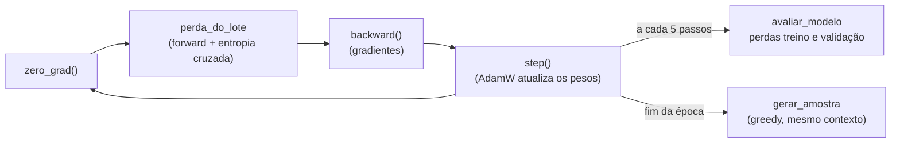
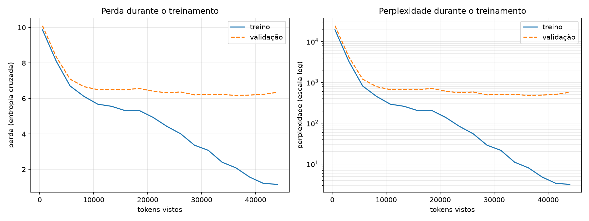
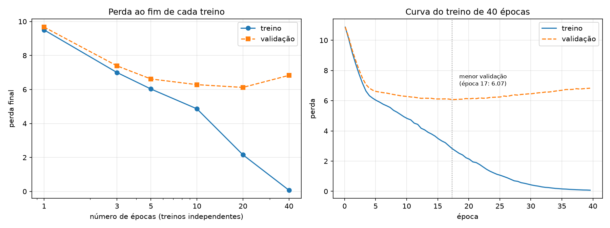
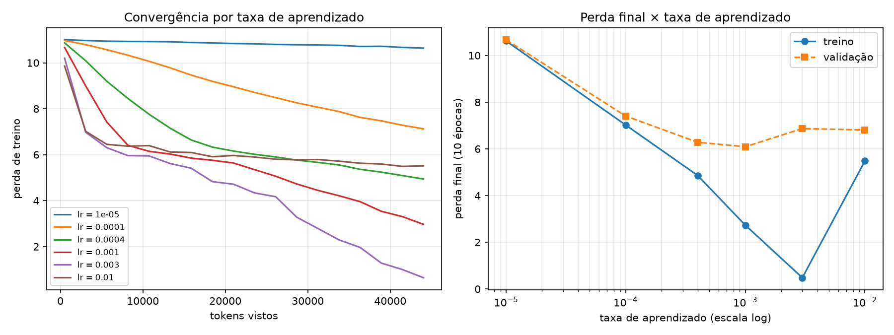
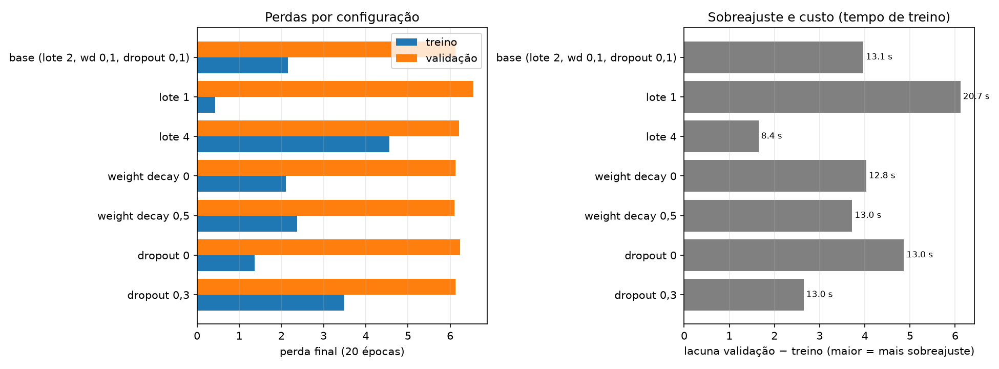
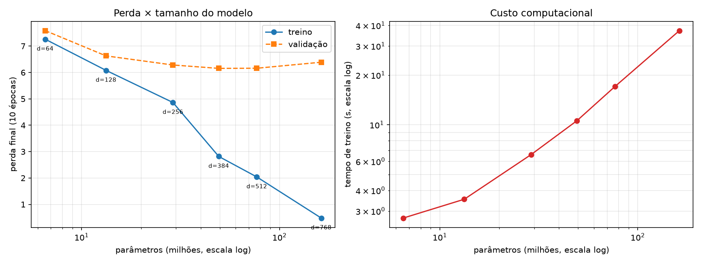
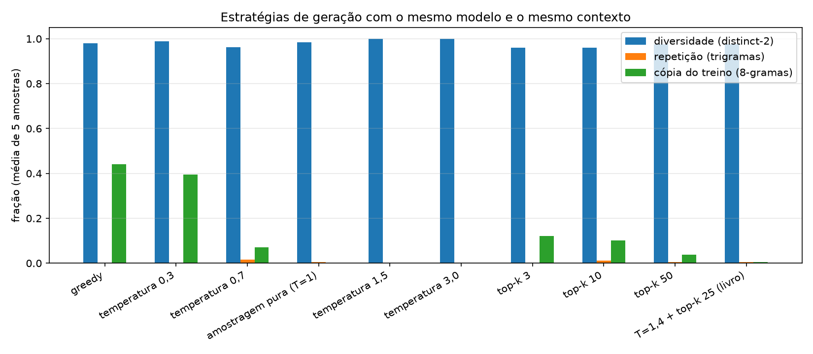
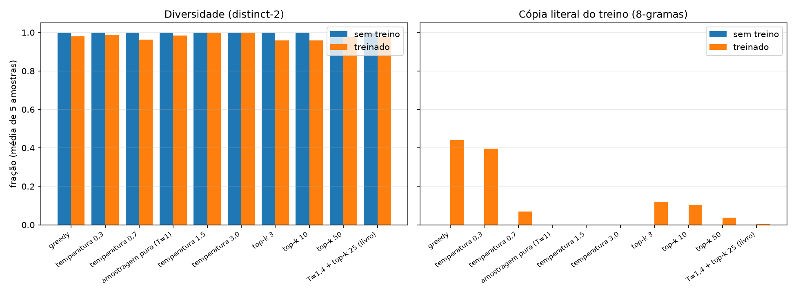

# Sprint 5 — Treinamento e Avaliação do Modelo GPT

**Capítulo 5 — *Pretraining on unlabeled data*** · RASCHKA, S. *Build a Large Language Model (From
Scratch)*, Manning.

---

## 1. Objetivo

Transformar o `GPTModel` da Sprint 4 — que, com pesos aleatórios, só produz tokens sem relação entre si
— em um modelo treinado: medir quantitativamente o seu erro, implementar o laço que reduz esse erro,
investigar como os parâmetros do treino e as estratégias de geração afetam o resultado e preservar os
pesos obtidos. O enunciado está em
[`documentation/instrucoes-sprints/sprint-05-treinamento.txt`](../documentation/instrucoes-sprints/sprint-05-treinamento.txt)
e o plano em tasks em [`documentation/specs/sprint05/plano.md`](../documentation/specs/sprint05/plano.md).

| Entregável | Onde |
|---|---|
| 1. Glossário | [`technical-glossary/capitulo-05.md`](../technical-glossary/capitulo-05.md) — 23 termos |
| 2. Avaliação do modelo | `perda_do_lote`, `perda_do_loader`, `perplexidade` em [`src/treinamento.py`](../src/treinamento.py); divisão treino/validação em [`src/dados.py`](../src/dados.py) — seções 2.2 e 4.1 |
| 3. Implementação do treinamento | `treinar_modelo`, `ConfigTreinamento` em [`src/treinamento.py`](../src/treinamento.py) — seções 2.3 e 4.1 |
| 4. Experimentos de treinamento | [`experiments/sprint05-treinamento/`](../experiments/sprint05-treinamento/) E1–E4 — seção 4.2 |
| 5. Estratégias de geração | E5 e E6 — seção 4.3 |
| 6. Salvamento e carregamento | [`src/checkpoint.py`](../src/checkpoint.py) — seções 2.4 e 4.4 |
| 7. Documentação técnica | este relatório, o [notebook](../notebook/sprint05-treinamento.ipynb) e os READMEs |

**Sobre os dados.** O enunciado cita uma pasta de dados no ambiente virtual da UNOESC, que exige login e
não pôde ser acessada durante a implementação. Todo o trabalho usa o corpus do capítulo,
[`sprints/the-verdict.txt`](../sprints/the-verdict.txt) (20.479 caracteres, 5.145 tokens BPE). O
corpus é um parâmetro (`ConfigTreinamento.corpus`): trocá-lo não exige alterar código.

---

## 2. Implementação

### 2.1 Organização

| Arquivo | Conteúdo |
|---|---|
| [`src/treinamento.py`](../src/treinamento.py) | Perda por lote e por loader, perplexidade, laço de treinamento, avaliação periódica, amostras por época e `ConfigTreinamento` |
| [`src/checkpoint.py`](../src/checkpoint.py) | Salvar, carregar e retomar a partir de um checkpoint |
| [`src/dados.py`](../src/dados.py) | Acrescenta a divisão treino/validação e os dois DataLoaders |
| [`src/validar_treinamento.py`](../src/validar_treinamento.py) | 27 verificações de todas as peças acima |
| [`experiments/sprint05-treinamento/`](../experiments/sprint05-treinamento/) | Treino base, inferência a partir do checkpoint e os experimentos E1–E6 |
| [`results-by-sprints/sprint05/`](../results-by-sprints/sprint05/) | Configurações, históricos, amostras, figuras, tabelas e logs |
| [`notebook/sprint05-treinamento.ipynb`](../notebook/sprint05-treinamento.ipynb) | O capítulo passo a passo, com saídas executadas |

Nada das sprints anteriores foi reescrito: o treinamento usa o `GPTModel` (Sprint 4), a `gerar`
(Sprint 4), o `TokenizadorBPE` e o `GPTDatasetV1` (Sprint 2) sem alterações. Cada task do plano foi
implementada, testada e commitada separadamente.

### 2.2 Avaliação (Entregável 2)

A **entropia cruzada** compara a distribuição prevista em cada posição com o token que de fato vem a
seguir — o alvo produzido pela janela deslizante da Sprint 2:

```
logits (b, L, V) ─flatten→ (b·L, V) ┐
                                    ├─ cross_entropy → ℒ = média de −log p(token correto)
alvos  (b, L)    ─flatten→ (b·L,)   ┘
```

- `perda_do_lote` devolve ℒ ainda ligado ao grafo, para a retropropagação;
- `perda_do_loader` faz a média sobre os lotes em `eval()` e `no_grad()`, restaura o modo anterior do
  modelo e aceita `num_lotes` para avaliações periódicas baratas;
- `perplexidade(ℒ) = exp(ℒ)`: o número efetivo de tokens entre os quais o modelo está em dúvida.

A divisão é **90% treino / 10% validação**, por caracteres e sem embaralhar: 18.431 caracteres (4.612
tokens, 9 lotes de 2 × 256) para treino e 2.048 (534 tokens, 1 lote) para validação, como no livro.

### 2.3 Treinamento (Entregável 3)

`treinar_modelo` (o `train_model_simple` do livro) executa, para cada época e cada lote:



Os parâmetros ficam em `ConfigTreinamento`, gravada em JSON e no checkpoint:

| Parâmetro | Valor (treino base, seção 5.2) |
|---|---|
| Modelo | GPT-2 124M: `emb_dim` 768, 12 blocos, 12 cabeças, `context_length` 256, dropout 0,1, 162.419.712 parâmetros |
| Épocas | 10 (90 passos) |
| Lote / contexto / stride | 2 / 256 / 256 |
| Otimizador | AdamW, `lr = 4e-4`, `weight_decay = 0,1` |
| Avaliação | a cada 5 passos, sobre 5 lotes |
| Semente | 123 |
| Hardware | NVIDIA GeForce GTX 1650, PyTorch 2.14.1+cu126, Python 3.14.5 |

### 2.4 Salvamento e carregamento (Entregável 6)

Um checkpoint é um único `.pt` com: `state_dict` do modelo, `state_dict` do AdamW, a configuração da
arquitetura, a configuração do treino, o histórico das perdas e as versões de Python e PyTorch. A
configuração é o que permite **identificar** o modelo e recriá-lo; o estado do otimizador é o que permite
**retomar** o treino.

| Função | O que faz |
|---|---|
| `salvar_checkpoint(caminho, modelo, otimizador, cfg_treino, historico)` | grava o arquivo |
| `carregar_checkpoint(caminho)` | recria o `GPTModel` pela configuração gravada, carrega os pesos (`weights_only=True`) e devolve o modelo em `eval()` |
| `retomar_treinamento(caminho)` | recria o AdamW registrado, restaura o seu estado e devolve o modelo em `train()` |

O procedimento completo, com os comandos, está no
[README dos experimentos](../experiments/sprint05-treinamento/README.md#salvamento-e-carregamento-dos-pesos).

### 2.5 Verificação

`uv run python src/validar_treinamento.py` → **27/27 verificações aprovadas**, entre elas:

- a perda é igual ao cálculo manual de `−log p(alvo)` e o modelo sem treino tem perda ≈ ln V;
- a divisão tem 9 lotes de treino e 1 de validação, como no livro;
- 40 épocas sobre um único lote reduzem a perda em mais de 50% (10,94 → 4,54);
- o modelo carregado produz logits e geração **idênticos**;
- treinar 8 passos de uma vez ou 3 + salvar + retomar + 5 dá pesos **idênticos** (diferença 0). Sem o
  estado do AdamW, a diferença é 7·10⁻³.

---

## 3. Experimentos

| Script | O que varia | Modelo |
|---|---|---|
| `treinar_base.py` | — (configuração do livro) | GPT-2 124M |
| `exp01_numero_de_epocas.py` | épocas: 1, 3, 5, 10, 20, 40 | reduzido |
| `exp02_taxa_de_aprendizado.py` | `lr`: 1e-5 … 1e-2 | reduzido |
| `exp03_configuracao_de_treino.py` | lote 1/2/4, weight decay 0/0,1/0,5, dropout 0/0,1/0,3 | reduzido |
| `exp04_tamanho_do_modelo.py` | `(emb_dim, n_layers, n_heads)`: 6,5 M a 162 M parâmetros | vários |
| `exp05_estrategias_de_geracao.py` | greedy, temperatura, top-k | 124M treinado |
| `exp06_geracao_vs_treinamento.py` | mesmas estratégias, pesos aleatórios × treinados | 124M |

O **modelo reduzido** (`emb_dim` 256, 4 blocos, 4 cabeças, 29 M parâmetros) mantém vocabulário, contexto
e dados do treino base e permite dezenas de treinos em minutos. Cada treino começa do zero com a semente
123; ao repetir todos os experimentos com `executar_todos.py`, perdas e métricas saíram **idênticas** às
das execuções individuais — só os tempos variam.

**Métricas de texto** (E5, E6), sobre os 50 tokens gerados e em média de 5 sementes: *distinct-n*
(fração de n-gramas distintos), *repetição de trigramas* e *cópia do treino* — a fração dos 8-gramas
gerados que existem literalmente no texto de treinamento, uma medida direta de memorização.

---

## 4. Resultados e análise

### 4.1 O treino base: o modelo aprende — e decora



| | Antes | Melhor validação (época 8) | Depois de 10 épocas |
|---|---|---|---|
| Perda de treino | 10,99 | 2,09 | **0,83** |
| Perplexidade de treino | 59.135 | 8,1 | **2,3** |
| Perda de validação | 10,98 | **6,17** | 6,36 |
| Perplexidade de validação | 58.753 | **479** | 581 |

Tempo: **49 s** na GPU, 46.080 tokens vistos.

**O estado inicial confirma a teoria.** A perda de 10,99 está a 0,17 de `ln(50257) = 10,82`, e a
perplexidade, da ordem de `V`, diz que o modelo não prefere nenhum token: é uma distribuição quase
uniforme. A amostra greedy da época 1 é só uma sequência de quebras de linha.

**O modelo efetivamente aprende a prever o próximo token.** A perda de treino cai monotonamente e a
perplexidade de treino chega a 2,3: no texto de treino, o modelo hesita, em média, entre pouco mais de
dois tokens. As amostras acompanham:

| Época | Amostra greedy de "Every effort moves you" |
|---|---|
| 1–3 | quebras de linha repetidas |
| 4 | *", and, and, and, and of the of the…"* |
| 6 | *"know the end. Gisburn--I he had a little that he had been his pictures…"* |
| 10 | *"know," was one of the axioms he had been the tips of a self-confident moustache, I felt to what a smile behind his close grayish beard…"* |

**Mas a validação estaciona.** Depois de ~10 mil tokens a perda de validação fica entre 6,2 e 6,6,
enquanto a de treino continua caindo. Perplexidade 2,3 no treino contra 581 na validação significa que o
modelo prevê bem o texto que viu e mal o texto que não viu. A amostra da época 10 confirma: são pedaços
do conto colados. É exatamente o comportamento descrito na seção 5.2 do livro.

### 4.2 Experimentos de treinamento (Entregável 4)

#### Número de épocas (E1)



| Épocas | Treino | Validação | Lacuna | Tempo |
|---|---|---|---|---|
| 1 | 9,50 | 9,67 | 0,17 | 0,9 s |
| 5 | 6,03 | 6,62 | 0,59 | 3,3 s |
| 10 | 4,86 | 6,28 | 1,42 | 6,4 s |
| 20 | 2,16 | **6,12** | 3,97 | 12,9 s |
| 40 | **0,07** | 6,83 | 6,76 | 25,8 s |

A validação tem o mínimo (6,07) por volta da **época 17** e depois **sobe**: com 40 épocas, o modelo
reduz o erro de treino a quase zero e piora no que não viu. A amostra de 40 épocas é uma frase literal do
conto (*"Yes--quite insensible to the irony. She wanted him vindicated--and by me!"*). O custo cresce
linearmente com as épocas; o benefício para a validação acaba bem antes. **Conclusão:** com estes dados,
mais de ~17 épocas só compra memorização. A escolha certa é parar quando a validação para de cair
(*early stopping*), não quando a de treino chega a zero.

#### Taxa de aprendizado (E2)



| `lr` | Treino | Validação | Instabilidade | Aumentos da perda |
|---|---|---|---|---|
| 1e-5 | 10,62 | 10,68 | 0,01 | 1 |
| 1e-4 | 7,02 | 7,41 | 0,04 | 0 |
| 4e-4 (livro) | 4,86 | 6,28 | 0,28 | 0 |
| 1e-3 | 2,74 | **6,09** | 0,47 | 0 |
| 3e-3 | 0,48 | 6,87 | 0,70 | 0 |
| 1e-2 | 5,48 | 6,81 | 0,66 | **4** |

As três regiões previstas aparecem com clareza:

- **Pequena demais:** com `1e-5`, 90 passos mal tiram o modelo do ponto inicial (10,62 ≈ ln V).
- **Útil:** `4e-4` e `1e-3` convergem sem oscilação. `1e-3` chega à melhor validação em 10 épocas
  porque anda mais rápido — mas é também a que entra antes no sobreajuste.
- **Grande demais:** `3e-3` decora o treino em 10 épocas (0,48) e piora a validação. `1e-2` passa a
  **instável**: a perda de treino sobe em 4 avaliações e termina em 5,48, pior que a de `1e-3`.

A taxa de aprendizado e o número de épocas não são independentes: uma taxa maior chega mais cedo ao
mesmo ponto da curva. Por isso a comparação só faz sentido com o mesmo número de passos.

#### Configuração do treino: lote, weight decay e dropout (E3, 20 épocas)



| Configuração | Passos | Treino | Validação | Lacuna | Tempo |
|---|---|---|---|---|---|
| base (lote 2, wd 0,1, dropout 0,1) | 180 | 2,16 | 6,12 | 3,97 | 13,1 s |
| lote 1 | 360 | 0,43 | 6,55 | 6,12 | 20,7 s |
| lote 4 | 80 | 4,56 | 6,20 | **1,65** | **8,4 s** |
| weight decay 0 | 180 | 2,10 | 6,13 | 4,03 | 12,8 s |
| weight decay 0,5 | 180 | 2,38 | **6,10** | 3,72 | 13,0 s |
| dropout 0 | 180 | 1,37 | 6,23 | 4,86 | 13,0 s |
| dropout 0,3 | 180 | 3,49 | 6,13 | **2,64** | 13,0 s |

- **Lote.** Com um corpus fixo, o lote decide quantos passos cabem numa época. Lote 1 dá o dobro de
  passos (e de atualizações com gradiente ruidoso), decora mais e tem a pior validação. Lote 4 dá menos
  da metade dos passos, a menor lacuna e o menor tempo — mas treina menos. Parte da diferença, portanto, é
  **quantidade de treino**, não só tamanho do lote.
- **Dropout.** É o regulador mais eficaz aqui: de 0 para 0,3, a lacuna cai de 4,86 para 2,64 com a mesma
  validação. O modelo é impedido de depender de combinações específicas de neurônios, e decorar fica
  mais difícil.
- **Weight decay.** Quase não muda nada nesta escala (validação entre 6,10 e 6,13). Com `lr = 4e-4`, a
  redução por passo é `η·λ·θ ≈ 4·10⁻⁵ θ`; em 180 passos, o efeito acumulado é pequeno.

Nenhuma configuração leva a validação muito abaixo de ~6,1. Regularizar reduz a lacuna, mas não cria
informação que os 4.600 tokens de treino não têm.

#### Tamanho do modelo e custo computacional (E4)



| `(emb_dim, n_layers, n_heads)` | Parâmetros | Pesos | Treino | Validação | Tempo |
|---|---|---|---|---|---|
| (64, 2, 2) | 6,5 M | 25 MB | 7,26 | 7,59 | 2,7 s |
| (128, 2, 4) | 13,3 M | 51 MB | 6,08 | 6,63 | 3,5 s |
| (256, 4, 4) | 29,0 M | 110 MB | 4,86 | 6,28 | 6,6 s |
| (384, 6, 6) | 49,3 M | 188 MB | 2,82 | **6,16** | 10,6 s |
| (512, 8, 8) | 76,8 M | 293 MB | 2,04 | **6,16** | 17,1 s |
| (768, 12, 12) | 162,4 M | 620 MB | **0,48** | 6,39 | 37,2 s |

Mais parâmetros reduzem a perda de treino continuamente, mas a de validação **para de melhorar a partir
de ~49 M** e piora no maior modelo, enquanto o tempo cresce ~14×. Nos modelos pequenos, a maior parte dos
parâmetros está nas tabelas de embedding e na cabeça de saída (`50.257 × emb_dim` cada); a profundidade
só pesa nos maiores. Com um corpus deste tamanho, o gargalo são os **dados**, não a capacidade.

### 4.3 Estratégias de geração (Entregável 5)

Mesmo modelo (checkpoint do treino base), mesmo contexto ("Every effort moves you"), 50 tokens, 5
sementes por estratégia ([amostras completas](../results-by-sprints/sprint05/exp05-amostras.txt)).



| Estratégia | distinct-2 | Repetição | Cópia do treino | Textos distintos (de 5) |
|---|---|---|---|---|
| greedy | 0,98 | 0,00 | **0,44** | 1 |
| temperatura 0,3 | 0,99 | 0,00 | 0,40 | 5 |
| temperatura 0,7 | 0,96 | 0,02 | 0,07 | 5 |
| amostragem pura (T = 1) | 0,98 | 0,00 | 0,00 | 5 |
| temperatura 1,5 | 1,00 | 0,00 | 0,00 | 5 |
| temperatura 3,0 | 1,00 | 0,00 | 0,00 | 5 |
| top-k 3 | 0,96 | 0,00 | 0,12 | 5 |
| top-k 10 | 0,96 | 0,01 | 0,10 | 5 |
| top-k 50 | 0,98 | 0,00 | 0,04 | 5 |
| T = 1,4 + top-k 25 (livro) | 0,98 | 0,00 | 0,00 | 5 |

- **Greedy** é determinístico (o mesmo texto nas 5 sementes) e é a que mais **copia**: 44% dos 8-gramas
  gerados estão literalmente no conto. É o modelo sobreajustado mostrando o que decorou.
- **Temperatura baixa (0,3)** fica próxima do greedy (40% de cópia), mas já varia entre sementes.
- **Temperatura ≥ 1** elimina a cópia, e a diversidade chega ao máximo. Só que a métrica não distingue
  diversidade de **incoerência**: com T = 3 o texto é uma lista de tokens raros (*"as studioBritishMaker
  moderatesadvantflower BoosterYes Participant…"*). Achatar a distribuição dá peso aos milhares de tokens
  que o modelo considera improváveis.
- **Top-k** resolve essa cauda: sorteia, mas só entre os `k` mais prováveis. Com k = 10 o texto é
  variado e ainda soa como o conto (*"say to the easel- too much a smile that lifted the tips of a
  self-confident moustache, I saw to what a degree he had the same quality as his pictures…"*).
- A combinação do livro (T = 1,4, top-k 25) fica no meio: nada de cópia, palavras do vocabulário do
  conto, coerência baixa.

As métricas medem repetição e cópia; **coerência** só se avalia lendo as amostras. Pela leitura, top-k
pequeno com temperatura ≈ 1 dá o melhor equilíbrio para este modelo.

### 4.4 O que vem da decodificação e o que vem do treino (E6)

As mesmas estratégias aplicadas ao mesmo GPT-2 124M **antes** do treino (pesos aleatórios, semente 123):



| | Sem treino | Treinado |
|---|---|---|
| distinct-2, todas as estratégias | 1,00 | 0,96–1,00 |
| Cópia do treino, greedy | 0,00 | 0,44 |
| Cópia do treino, T = 1 | 0,00 | 0,00 |
| Greedy | *" rentingetic wasnم refres RexMeCHicular stren Mortgage…"* | *"know," was one of the axioms he had been the tips of a self-confident moustache…"* |

Sem treino, **nenhuma** estratégia produz texto: greedy, temperatura e top-k só escolhem de modos
diferentes dentro de uma distribuição quase uniforme, e o resultado é sempre uma sequência de tokens sem
relação ([amostras](../results-by-sprints/sprint05/exp06-amostras-sem-treino.txt)). Depois do treino, a
mesma regra greedy reproduz o conto, e as outras estratégias passam a ter efeito visível.

A separação é, portanto:

- **o treinamento define a distribuição** — quais tokens são plausíveis depois de cada contexto, e quanto
  do corpus foi decorado;
- **a decodificação só escolhe dentro dela** — trocando previsibilidade (greedy, cópia) por variedade
  (temperatura, top-k).

Nenhuma estratégia corrige um modelo mal treinado. Uma estratégia ruim (T = 3), por outro lado, pode
estragar a saída de um modelo bem treinado.

### 4.5 Salvamento e carregamento (Entregável 6)

O checkpoint do treino base (`base-modelo.pt`, 1,95 GB: ~620 MB de pesos e o dobro disso no estado do
AdamW) foi recarregado por `gerar_com_checkpoint.py`, num processo separado e sem nenhum treino. A
geração greedy de 50 tokens foi **idêntica** à amostra registrada na época 10 durante o treino. O script
mostra a arquitetura e a configuração lidas do arquivo, o que identifica o modelo sem consultar o código
que o treinou.

---

## 5. Síntese

1. **A perda mede o que o modelo sabe; a perplexidade traduz.** O modelo sem treino está em ln V
   (perplexidade ≈ V); o treinado chega a 2,3 de perplexidade no treino.
2. **O laço de treinamento funciona**: a perda cai e as amostras evoluem de quebras de linha a frases do
   conto em 49 s.
3. **Com 5 mil tokens, o modelo decora.** A validação estaciona em ~6,1–6,3 (perplexidade ~500) em
   qualquer configuração. Mais épocas, taxa maior ou modelo maior só aceleram a memorização.
4. **Dropout é o regulador mais eficaz** nesta escala. O weight decay quase não atua em treinos tão
   curtos.
5. **A decodificação não substitui o treino**: ela controla a troca entre cópia e diversidade, mas só
   dentro do que os pesos aprenderam.
6. **O checkpoint preserva tudo**: pesos, otimizador e configuração. O modelo recarregado é idêntico, e
   um treino retomado é exatamente o mesmo de um treino contínuo.

## 6. Limitações e próximos passos

- **Dados.** O corpus tem 4.612 tokens de treino e 534 de validação; um único lote de validação torna a
  perda de validação ruidosa. Os dados da pasta da disciplina, não acessados nesta sprint, devem
  substituir `the-verdict.txt` (é só mudar `ConfigTreinamento.corpus`).
- **Validação contínua.** A validação é o fim do conto, com personagens e estilo próximos do treino. Um
  texto de outra fonte mediria melhor a generalização.
- **Métricas de texto.** distinct-n, repetição e cópia não medem coerência; a análise de coerência é
  qualitativa.
- **Ordem dos lotes e semente.** O treino base avalia o modelo antes de treinar. Como o loader de treino
  embaralha, essa avaliação consome o gerador aleatório e muda a ordem dos lotes. Por isso o GPT-2 124M
  termina com perda 0,83 no treino base e 0,48 no E4, com a mesma configuração. Cada experimento é
  reprodutível em si, mas comparações entre scripts diferentes devem considerar essa diferença.
- **Escala.** Sem *learning rate warmup*, *cosine decay*, *gradient clipping* nem pesos pré-treinados da
  OpenAI (seção 5.5 e apêndice D do livro), que ficam como extensões para a Sprint 6.

## 7. Entregáveis da Sprint 5

| Entregável | Onde |
|---|---|
| Glossário atualizado | [`technical-glossary/capitulo-05.md`](../technical-glossary/capitulo-05.md) |
| Avaliação (entropia cruzada, perplexidade, treino/validação) | [`src/treinamento.py`](../src/treinamento.py), [`src/dados.py`](../src/dados.py) |
| Rotina de treinamento | [`src/treinamento.py`](../src/treinamento.py), [`experiments/sprint05-treinamento/treinar_base.py`](../experiments/sprint05-treinamento/treinar_base.py) |
| Experimentos de treinamento | E1–E4 em [`experiments/sprint05-treinamento/`](../experiments/sprint05-treinamento/) |
| Estratégias de geração | E5–E6 |
| Salvamento e carregamento | [`src/checkpoint.py`](../src/checkpoint.py), [`gerar_com_checkpoint.py`](../experiments/sprint05-treinamento/gerar_com_checkpoint.py) |
| Registros de perdas e amostras | [`results-by-sprints/sprint05/`](../results-by-sprints/sprint05/) |
| Notebook | [`notebook/sprint05-treinamento.ipynb`](../notebook/sprint05-treinamento.ipynb) |
| Validação | [`src/validar_treinamento.py`](../src/validar_treinamento.py) — 27/27 |

## Referência

RASCHKA, Sebastian. **Build a Large Language Model (From Scratch)**. Manning Publications. Capítulo 5.
