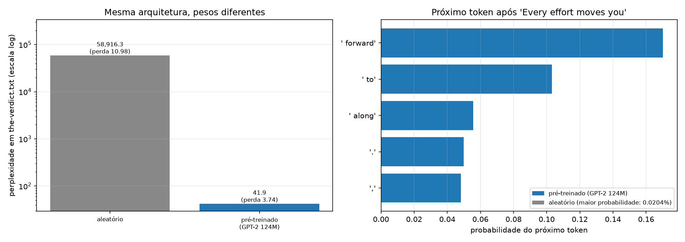
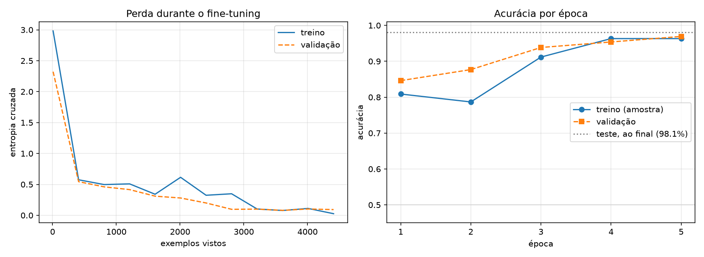
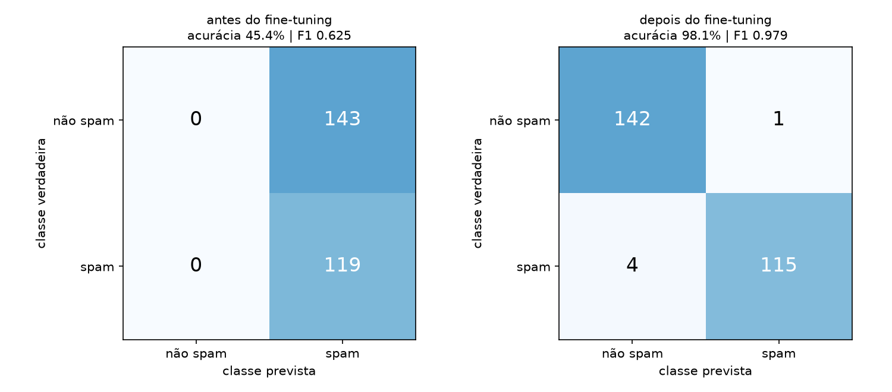
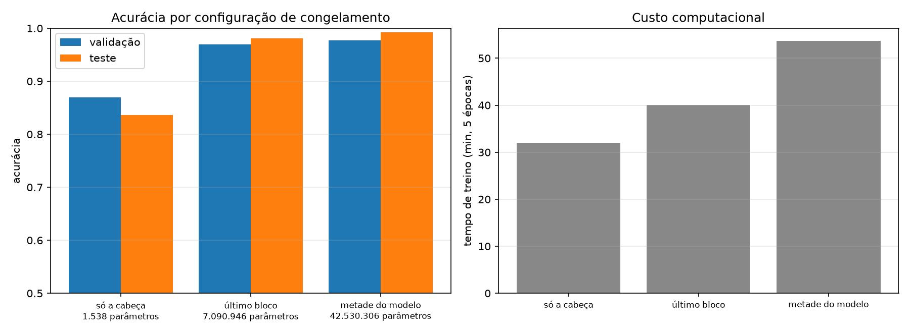
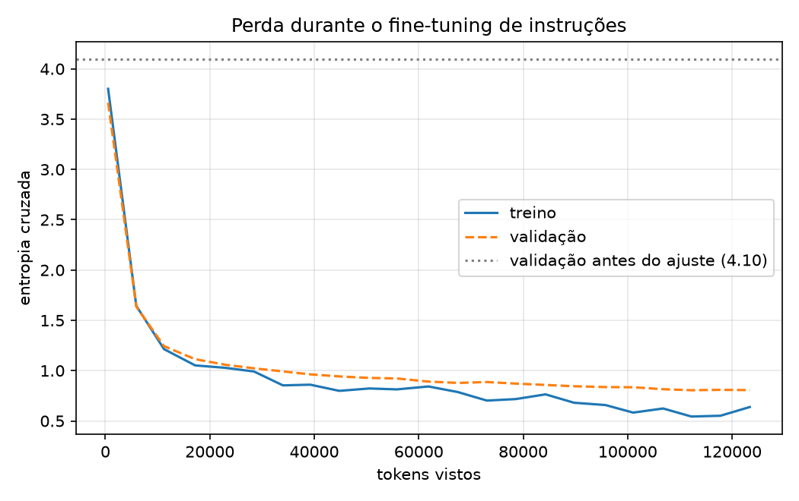
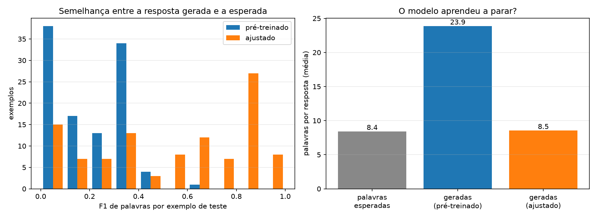

# Sprint 6 — Pesos Pré-treinados e Fine-tuning

**Seção 5.5, Capítulo 6 — *Fine-tuning for classification*** e **Capítulo 7 — *Fine-tuning to follow
instructions*** · RASCHKA, S. *Build a Large Language Model (From Scratch)*, Manning.

---

## 1. Objetivo

Sair do modelo treinado do zero em 5 mil tokens — que só decora — para um modelo que parte dos pesos
do GPT-2 publicados pela OpenAI e é adaptado a duas tarefas: classificar mensagens e responder a
instruções. O enunciado está em
[`documentation/instrucoes-sprints/sprint-06-fine-tuning.txt`](../documentation/instrucoes-sprints/sprint-06-fine-tuning.txt)
e o plano em tasks em [`documentation/specs/sprint06/plano.md`](../documentation/specs/sprint06/plano.md).

| Entregável | Onde |
|---|---|
| 1. Glossário | [`capitulo-06.md`](../technical-glossary/capitulo-06.md) (16 termos) e [`capitulo-07.md`](../technical-glossary/capitulo-07.md) (8 termos) — os 14 exigidos e 10 de apoio |
| 2. Carregamento de pesos pré-treinados | [`src/pesos_pretreinados.py`](../src/pesos_pretreinados.py) — seções 2.2 e 4.1 |
| 3. Fine-tuning de classificação | [`src/classificacao.py`](../src/classificacao.py), [`treinar_classificador.py`](../experiments/sprint06-fine-tuning/treinar_classificador.py) — seções 2.3 e 4.2 |
| 4. Avaliação do classificador | `metricas_de_classificacao`; experimentos 02 a 04 — seções 4.2 a 4.4 |
| 5. Fine-tuning de instruções | [`src/instrucoes.py`](../src/instrucoes.py), [`treinar_instrucoes.py`](../experiments/sprint06-fine-tuning/treinar_instrucoes.py); experimentos 05 e 06 — seções 2.4 e 4.5 |
| Integração final | [`src/demonstracao_pipeline.py`](../src/demonstracao_pipeline.py), [`relatorio-final.md`](relatorio-final.md), [`glossario-consolidado.md`](../technical-glossary/glossario-consolidado.md) |

**Sobre os dados.** A pasta de dados da disciplina exige login e não pôde ser acessada. A sprint usa as
bases do livro: a *SMS Spam Collection* (UCI, CC BY 4.0) e o `instruction-data.json` do Capítulo 7,
ambas versionadas em [`sprints/dados/`](../sprints/dados/). Os caminhos são parâmetros.

**Sobre a máquina.** Tudo foi executado em **CPU, com 7,5 GB de RAM**. Isso moldou três decisões,
registradas onde aparecem: só um modelo de 124M na memória por vez, 6 blocos em vez do modelo inteiro
no experimento de congelamento e no fine-tuning de instruções, e o GPT-2 124M em vez do 355M nas
instruções.

---

## 2. Implementação

### 2.1 Organização

| Arquivo | Conteúdo |
|---|---|
| [`src/pesos_pretreinados.py`](../src/pesos_pretreinados.py) | Download, tabela de correspondência arquivo → modelo, cópia com conferência de formas |
| [`src/classificacao.py`](../src/classificacao.py) | Base de spam, dataset, cabeça de classificação e congelamento, perda, acurácia, métricas, laço de treino, uso do classificador |
| [`src/instrucoes.py`](../src/instrucoes.py) | Formato do prompt, dataset, montagem dos lotes, seleção de camadas treináveis, geração e avaliação das respostas |
| [`src/validar_fine_tuning.py`](../src/validar_fine_tuning.py) | 56 verificações de todas as peças acima |
| [`experiments/sprint06-fine-tuning/`](../experiments/sprint06-fine-tuning/) | Dois treinos e seis experimentos |
| [`results-by-sprints/sprint06/`](../results-by-sprints/sprint06/) | Configurações, históricos, figuras, tabelas, respostas geradas e logs |
| [`notebook/sprint06-fine-tuning.ipynb`](../notebook/sprint06-fine-tuning.ipynb) | Os dois capítulos passo a passo, com saídas executadas |

Nada das sprints anteriores foi reescrito. O `GPTModel` (Sprint 4) recebe os pesos sem alteração de
código; o fine-tuning de instruções usa o `treinar_modelo` e a `perda_do_lote` da Sprint 5 como estão.
Cada task do plano foi implementada, testada e commitada separadamente.

### 2.2 Pesos pré-treinados (Entregável 2)

O livro lê os checkpoints do TensorFlow da OpenAI. Aqui os mesmos pesos são baixados no formato
`safetensors` (`openai-community/gpt2`, no Hugging Face Hub) e lidos com a biblioteca `safetensors`,
que devolve apenas um dicionário nome → tensor. **Nenhuma classe de modelo pronta é usada**: a
correspondência entre os 160 tensores do arquivo e os parâmetros do `GPTModel` é a tabela
`mapa_de_parametros`, escrita para o projeto.

| No arquivo | No `GPTModel` | Operação |
|---|---|---|
| `wte.weight`, `wpe.weight` | `embedding.token_emb`, `embedding.pos_emb` | cópia |
| `h.i.attn.c_attn.weight` `(d, 3d)` | `W_query`, `W_key`, `W_value` `(d, d)` | fatiar em três e transpor |
| `h.i.attn.c_attn.bias` `(3d,)` | bias de Q, K e V | fatiar em três |
| `h.i.attn.c_proj`, `h.i.mlp.c_fc`, `h.i.mlp.c_proj` | `out_proj`, `ff.layers[0]`, `ff.layers[2]` | transpor o peso |
| `ln_1`, `ln_2`, `ln_f` (`weight`, `bias`) | `scale`, `shift` das `LayerNorm` | cópia |
| `wte.weight` | `out_head.weight` | cópia (*weight tying*) |
| `h.i.attn.bias` | — | ignorado: é a máscara causal |

As transposições existem porque o GPT-2 original usa camadas `Conv1D`, que guardam o peso como
`(entrada, saída)`; o `nn.Linear` guarda `(saída, entrada)`. `carregar_pesos_gpt2` confere **todas** as
formas antes de copiar o primeiro tensor: um modelo configurado de forma incompatível produz um
`ValueError` que diz qual parâmetro diverge, e não um modelo com parte dos pesos trocada. Por isso a
configuração muda em relação à Sprint 5: `context_length = 1024` e `qkv_bias = True`.

A verificação mais forte está em `validar_fine_tuning.py`: um GPT-2 escrito diretamente sobre os
tensores do arquivo, na convenção do arquivo e sem usar nenhuma classe de `gpt.py`, produz os mesmos
logits que o `GPTModel` carregado (diferença máxima de 1,7 × 10⁻⁶).

### 2.3 Fine-tuning de classificação (Entregáveis 3 e 4)

**Dados.** 5.574 mensagens → 5.171 após remover duplicatas → 1.306 após balancear (653 de cada classe)
→ 914 / 130 / 262 (treino / validação / teste). A remoção de duplicatas **não está no livro**: a base
tem 403 mensagens repetidas, e sem a remoção a mesma mensagem poderia estar no treino e no teste,
inflando a acurácia. As mensagens são completadas à direita com `<|endoftext|>` até 188 tokens, o
comprimento da maior do treino.

**Modelo.** `adaptar_para_classificacao` troca `out_head` por uma `Linear(768, 2)` de pesos aleatórios
e congela tudo, exceto a cabeça, o último bloco Transformer e a `LayerNorm` final: 7.090.946 parâmetros
treináveis de 124.441.346 (5,7%).

**Perda e previsão.** Entropia cruzada entre os 2 logits **do último token** e o rótulo. A última
posição é a única que, pela máscara causal, enxerga a mensagem inteira.

**Treino.** `treinar_classificador`: 5 épocas, AdamW (`lr = 5e-5`, `weight_decay = 0,1`), lotes de 8,
avaliação a cada 50 passos, acurácia de treino e de validação a cada época.

**Métricas.** Matriz de confusão, precisão, revocação e F1 implementadas no projeto
(`metricas_da_matriz`), com *spam* como classe positiva, sem scikit-learn.

### 2.4 Fine-tuning de instruções (Entregável 5)

**Dados.** 1.100 exemplos → 1.075 após remover 25 pares (instrução, entrada) repetidos → 913 / 55 / 107.
Também aqui a remoção não está no livro; com a divisão dele, 2 perguntas do teste e 4 da validação
estavam no treino.

**Prompt.** Formato Alpaca (`formatar_exemplo`): frase de abertura, `### Instruction:`, `### Input:`
(omitido se vazio) e `### Response:`. `montar_prompt` é o mesmo texto cortado depois de
`### Response:\n`; um teste confere que ele é prefixo exato, em tokens, dos exemplos de treino.

**Lotes.** `agrupar_lote` acrescenta `<|endoftext|>` a cada exemplo, completa até o maior **do lote**,
desloca o alvo em uma posição e troca o padding do alvo por `-100`, que a entropia cruzada ignora. O
`<|endoftext|>` que sobra no alvo é o que ensina o modelo a parar.

**Treino.** `treinar_modelo` da Sprint 5, sem alteração: 2 épocas, AdamW (`lr = 5e-5`,
`weight_decay = 0,1`), lotes de 8. `definir_treinaveis` deixa treináveis os 6 últimos blocos e a norma
final: 42.528.768 parâmetros de 163.037.184 (26%). O total é maior que os 124M nominais porque, no
`GPTModel`, a cabeça de saída é um tensor separado da tabela de tokens, embora carregue os mesmos
valores.

**Geração.** `responder` gera de forma *greedy* a partir do prompt, para ao produzir `<|endoftext|>` e
devolve só o texto depois de `### Response:`.

**Avaliação.** Correspondência exata e F1 de palavras (`avaliar_respostas`), mais uma amostra para
leitura. O livro usa um segundo LLM (Llama 3, via Ollama) como juiz; não foi usado, por depender de um
modelo pronto de terceiros, o que foge da proposta do projeto.

### 2.5 Verificação

```bash
uv run python src/validar_fine_tuning.py
```

56 verificações, com modelos pequenos, em menos de um minuto de CPU: tabela de correspondência e carga
dos pesos, dados e dataset de classificação, cabeça e congelamento, perda, acurácia, matriz de
confusão, laço de treino, formato do prompt, montagem dos lotes, geração da resposta e métricas de
avaliação. `--completo` acrescenta a carga do GPT-2 124M real.

---

## 3. Experimentos

| Script | O que varia | O que fica fixo |
|---|---|---|
| `exp01_aleatorio_vs_pretreinado.py` | os pesos: aleatórios × GPT-2 | arquitetura, texto, estratégias de geração |
| `treinar_classificador.py` | — (treino base) | — |
| `exp02_antes_e_depois.py` | os pesos: antes × depois do ajuste | conjunto de teste |
| `exp03_camadas_treinaveis.py` | o que é treinável: só a cabeça, 1 bloco, 6 blocos | dados, hiperparâmetros, semente |
| `exp04_token_de_classificacao.py` | a posição lida: último × primeiro token | idem |
| `treinar_instrucoes.py` | — (treino de instruções) | — |
| `exp05_respostas_de_teste.py` | os pesos: pré-treinados × ajustados | prompts de teste, geração *greedy*, limite de 48 tokens |
| `exp06_avaliacao_das_respostas.py` | — (mede as respostas do 05) | — |

Todos os treinos usam a semente 123. Os experimentos 03 e 04 reaproveitam o resultado do treino base em
vez de refazê-lo.

---

## 4. Resultados e análise

### 4.1 Pesos aleatórios × pesos pré-treinados (Entregável 2)

Mesmo `GPTModel`, mesmo texto (`the-verdict.txt`, janelas de 256 tokens), só os pesos mudam:

| Pesos | Perda | Perplexidade | Token mais provável após "Every effort moves you" |
|---|---|---|---|
| aleatórios | 10,98 | 58.916 | `arcity` (0,02%) |
| GPT-2 124M | 3,74 | 41,9 | ` forward` (17,0%) |



O modelo aleatório está em `ln(50257) = 10,82`: todos os tokens são quase igualmente prováveis, e a
perplexidade tem a ordem de grandeza do vocabulário. Com os pesos do GPT-2, o modelo fica, em média,
tão incerto quanto alguém que escolhe entre 42 tokens. Para comparação, o modelo treinado do zero na
Sprint 5 tinha perplexidade ≈ 500 na validação — e naquele caso a validação era o fim do mesmo conto.

Na geração *greedy*:

> **aleatório:** Every effort moves youarcity warrQu motivateYS Coreints kernel 220redited Tooth m BLACK…
>
> **GPT-2:** Every effort moves you forward. The first step is to understand the importance of your work.

A geração *greedy* do GPT-2 entra em repetição (45% dos trigramas repetem um anterior); com temperatura
1,0 e top-k 50, a repetição some. É o mesmo efeito da Sprint 5, agora num modelo que sabe a língua: a
decodificação molda o texto, os pesos decidem se ele faz sentido. Amostras completas em
[`exp01-amostras.txt`](../results-by-sprints/sprint06/exp01-amostras.txt).

### 4.2 O classificador: treino e avaliação (Entregáveis 3 e 4)



| Época | Acurácia de treino | Acurácia de validação |
|---|---|---|
| 1 | 80,9% | 84,6% |
| 2 | 78,7% | 87,7% |
| 3 | 91,2% | 93,9% |
| 4 | 96,3% | 95,4% |
| 5 | 96,3% | 96,9% |

A perda cai de 2,98 para 0,03 no treino e 0,09 na validação, e as acurácias andam juntas: não há sinal de sobreajuste em 5
épocas. Ao final, nos conjuntos inteiros: treino 96,6%, validação 96,9%, **teste 98,1%**. O treino
levou 40,0 min em CPU.

No conjunto de teste (262 mensagens que não participaram de nenhuma decisão):

| | Acurácia | Precisão | Revocação | F1 | VP | FP | VN | FN |
|---|---|---|---|---|---|---|---|---|
| antes do ajuste | 45,4% | 45,4% | 100% | 0,625 | 119 | 143 | 0 | 0 |
| depois do ajuste | **98,1%** | 99,1% | 96,6% | **0,979** | 115 | 1 | 142 | 4 |



**Antes**, a cabeça é aleatória e o modelo responde "spam" para todas as mensagens: acerta exatamente a
fração de spam do teste (45,4%), com revocação de 100% e nenhum verdadeiro negativo. A acurácia não é
50% porque o resultado de um classificador constante depende só da proporção das classes — e é por isso
que a acurácia precisa vir acompanhada da matriz de confusão.

**Depois**, 5 erros em 262. O perfil dos erros é o desejável num filtro: 1 falso positivo (mensagem
legítima bloqueada, o erro mais caro) contra 4 falsos negativos (spam que passa). Os 5 erros estão em
[`exp02-erros-e-exemplos.txt`](../results-by-sprints/sprint06/exp02-erros-e-exemplos.txt): o falso
positivo é uma mensagem que contém só um endereço de site; os falsos negativos são spams redigidos como
avisos comuns ("You will be receiving this week's Triple Echo ringtone shortly"), sem as marcas típicas
— prêmio, urgência, número para ligar.

Em mensagens novas, escritas para o teste, o classificador ajustado acerta as quatro (P(spam) de 0,86 e
0,80 para os dois spams; 0,002 e 0,005 para as duas legítimas).

### 4.3 Quanto do modelo precisa ser treinado (Entregável 4)

| Treinável | Parâmetros treináveis | Validação | Teste | Tempo (CPU) |
|---|---|---|---|---|
| só a cabeça | 1.538 (0,001%) | 86,9% | 83,6% | 32,0 min |
| último bloco + norma final + cabeça | 7.090.946 (5,7%) | 96,9% | 98,1% | 40,0 min |
| 6 últimos blocos + norma final + cabeça | 42.530.306 (34,2%) | 97,7% | 99,2% | 53,7 min |



- **Só a cabeça já chega a 83,6%.** Os vetores que o GPT-2 pré-treinado produz separam boa parte das
  mensagens sem nenhum ajuste: é o aprendizado por transferência em sua forma mais simples. Mas esses
  vetores foram feitos para prever o próximo token, não para resumir a mensagem.
- **Liberar um bloco vale 14,5 pontos.** O último bloco passa a reorganizar o vetor do último token
  para a tarefa.
- **Liberar seis rende mais 1,1 ponto** — 3 mensagens em 262 — por 34% a mais de tempo e 6 vezes mais
  parâmetros. Com uma só semente, essa diferença não é conclusiva.
- **O tempo cai pouco quando se congela mais** (32 min com 1.538 parâmetros treináveis): o passo direto
  pelos 12 blocos é feito em todo lote, treine-se o que for. O congelamento economiza a
  retropropagação e a memória do otimizador, não o passo direto.

O plano previa treinar o modelo inteiro; com 7,5 GB de RAM isso não coube com folga, e a comparação
ficou em 6 blocos.

### 4.4 De qual token ler a classe (Entregável 4)

| Posição lida | O que ela enxerga | Validação | Teste |
|---|---|---|---|
| último token | a mensagem inteira | 96,9% | 98,1% |
| primeiro token | só a si mesmo | 68,5% | 64,5% |

Com o mesmo treino, ler a classe no primeiro token derruba a acurácia em 33,6 pontos. A causa é a
máscara causal da Sprint 3: na primeira posição, o modelo só tem o primeiro token da mensagem. Como
referência, uma tabela de contagem — para cada primeiro token, a classe mais frequente entre as
mensagens de treino que começam com ele — acerta 74,4% no teste. Lendo a primeira posição, o GPT-2
ajustado fica **abaixo** dessa tabela: tudo o que ele pode fazer ali é associar primeiras palavras a
classes, e 5 épocas com taxa de aprendizado baixa não bastaram nem para decorar essa associação.

É a confirmação experimental, pelo resultado, de uma propriedade que a Sprint 3 tinha verificado pela
matemática (perturbar um token futuro não altera os anteriores).

### 4.5 Fine-tuning de instruções (Entregável 5)



| | Perda de treino | Perda de validação | Perplexidade de validação |
|---|---|---|---|
| antes do ajuste | 4,01 | 4,10 | 60,1 |
| depois de 2 épocas | 0,60 | 0,78 | 2,2 |

O treino levou 14,4 min em CPU (228 passos). A perda cai depressa nos primeiros 40 passos — de 4,1
para ≈ 1,0 — porque a maior parte de cada prompt é o molde fixo (abertura, `### Instruction:`,
`### Response:`), que o modelo aprende a prever quase com certeza. O ganho seguinte, mais lento, é o
que corresponde às respostas. Treino e validação seguem próximos (0,60 e 0,78): em 2 épocas não há
sobreajuste relevante.

A resposta à mesma instrução de validação, ao fim de cada época
([`instrucoes-amostras.txt`](../results-by-sprints/sprint06/instrucoes-amostras.txt)):

> **Instrução:** What is the past tense of 'think'? — **esperada:** The past tense of 'think' is 'thought'.
>
> **Época 1:** The past tense of 'think' is 'think'.
>
> **Época 2:** The past tense of 'think' is 'to think'.

O exemplo resume o resultado da sprint: o modelo aprendeu **o formato** — repete a estrutura da
pergunta na resposta e emite `<|endoftext|>` logo depois — mas **erra o conteúdo**.

#### Respostas no conjunto de teste

107 instruções que o modelo não viu, geração *greedy*, limite de 48 tokens por resposta
([`exp05-respostas-de-teste.json`](../results-by-sprints/sprint06/exp05-respostas-de-teste.json)):

| Modelo | Correspondência exata | F1 de palavras | Palavras por resposta | Tokens por resposta |
|---|---|---|---|---|
| GPT-2 124M pré-treinado | 0,0% | 0,203 | 23,9 | 46,6 |
| GPT-2 124M ajustado | 7,5% (8 de 107) | 0,528 | 8,5 | 12,1 |
| *respostas esperadas* | — | — | 8,4 | — |



**O que o ajuste mudou — o comportamento.** O modelo pré-treinado não atende ao pedido: repete a
instrução, a entrada ou o próprio molde (`### Response:` de novo e de novo) até esgotar os 48 tokens.
O modelo ajustado responde uma vez e para: 106 das 107 respostas terminaram antes do limite, com 8,5
palavras em média — praticamente o comprimento das respostas esperadas (8,4). Ele aprendeu a emitir
`<|endoftext|>` e a devolver uma frase no formato das respostas da base.

> **Instrução:** Combine the two sentences into a single coherent sentence. *She studied hard. She passed the exam.*
>
> **Antes:** She passed the exam. ### Output: She passed the exam. ### Error: She passed the exam. ### Error: …
>
> **Depois:** She passed the exam.
>
> **Esperada:** She studied hard, so she passed the exam.

**O que o ajuste não deu — o conteúdo.** Só 8 respostas coincidem com a esperada, todas de padrões
muito repetidos na base (antônimos, capitais, fórmulas conhecidas: "The opposite of 'hot' is 'cold'.").
Na leitura da amostra
([`exp06-amostra-para-leitura.txt`](../results-by-sprints/sprint06/exp06-amostra-para-leitura.txt)),
a maioria das demais respostas tem a forma certa e o conteúdo errado:

| Instrução | Esperada | Modelo ajustado | F1 |
|---|---|---|---|
| What is the chemical formula for ammonium nitrate? | …is NH4NO3. | The chemical formula for ammonium nitrate is NaCl. | 0,88 |
| What is the past tense of 'throw'? | …is 'threw'. | The past tense of 'throw' is 'throw'. | 0,86 |
| Convert 3 kilometers to meters. | 3 kilometers is 3000 meters. | 3 kilometers is equal to 3. | 0,55 |
| Name the author of 'Pride and Prejudice'. | Jane Austen. | The author of 'Pride and Prejudice' is William Shakespeare. | 0,00 |

Dois padrões de erro se destacam:

- **Cópia da entrada.** Em 16 das 30 instruções de teste com campo de entrada, a resposta é a própria
  entrada, sem a transformação pedida (voz ativa, correção ortográfica, reescrita). Nenhuma das 30
  teve correspondência exata. O modelo aprendeu que a resposta "se parece" com a entrada, mas não a
  operação.
- **Molde certo, fato errado.** O modelo reaproveita a pergunta para montar a frase e preenche a
  lacuna com algo plausível na forma (uma fórmula química, um verbo) e errado no conteúdo.

**O que as métricas enxergam.** O F1 de palavras sobe de 0,20 para 0,53, e essa alta é real: as
respostas ficaram muito mais próximas das esperadas. Mas a tabela acima mostra o limite da métrica:
a resposta com a fórmula química errada tem F1 0,88, porque 7 das 8 palavras coincidem, e "Jane Austen"
respondido por extenso e certo teria F1 baixo contra a resposta curta esperada. **F1 de palavras mede
semelhança de redação, não correção** — num conjunto em que a resposta repete a pergunta, uma parte
grande do F1 vem do molde. A correspondência exata (7,5%) é o limite inferior da taxa de acerto, e a
leitura da amostra indica que a taxa real está perto dele. É por isso que o livro recorre a um segundo
modelo como juiz.

**Por que o conteúdo é fraco.** São três causas, todas da escala: o modelo é o GPT-2 124M (o livro usa
o 355M, e mesmo assim relata respostas erradas); só os 6 últimos blocos foram ajustados; e 913 exemplos
ensinam um formato, não fatos. O conhecimento factual precisa já estar no modelo pré-treinado — e o
GPT-2 124M sabe pouco. A perda de validação de 0,78 é coerente com isso: boa parte dos tokens de cada
exemplo é molde previsível, de modo que a perda pode ser baixa com as lacunas erradas.

---

## 5. Síntese

1. **O conhecimento está nos pesos, não no código.** O mesmo `GPTModel` tem perplexidade 58.916 com
   pesos aleatórios e 41,9 com os do GPT-2.
2. **Carregar pesos é um problema de correspondência**, e errar é silencioso: uma transposição
   esquecida não gera erro, só um modelo ruim. Conferir formas e comparar logits com uma implementação
   independente é o que garante a carga.
3. **Poucos dados bastam quando o ponto de partida é bom.** 914 mensagens e 5,7% dos parâmetros levam o
   classificador de 45,4% a 98,1% no teste.
4. **A acurácia sozinha engana.** Antes do ajuste, 45,4% de acurácia eram um modelo que respondia
   "spam" para tudo; a matriz de confusão mostra isso de imediato.
5. **A arquitetura dita onde ler a resposta.** Último token: 98,1%. Primeiro token: 64,5%.
6. **Instruções mudam os dados, não o modelo.** Mesma cabeça, mesma perda, mesmo laço da Sprint 5; o
   formato do prompt, o `-100` no padding e o `<|endoftext|>` no alvo fazem o resto.
7. **O fine-tuning de instruções ensinou o formato, não o conteúdo.** O modelo ajustado responde uma
   vez e para (8,5 palavras por resposta, contra 8,4 esperadas e 23,9 do pré-treinado), mas só 7,5% das
   respostas coincidem com a esperada.
8. **Métrica de sobreposição não é métrica de correção.** Uma fórmula química errada tem F1 0,88; a
   leitura de amostras continua indispensável.

## 6. Limitações e próximos passos

- **CPU e 7,5 GB de RAM.** O fine-tuning de instruções usou o GPT-2 124M com 6 blocos treináveis; o
  livro ajusta o 355M inteiro, que responde bem melhor. Numa GPU, basta trocar `tamanho` e
  `blocos_treinaveis` em `TREINO_INSTRUCOES`. O experimento de congelamento não incluiu o modelo
  inteiro.
- **Uma semente por configuração.** No teste de classificação cada mensagem vale 0,4 ponto; diferenças
  de 1 a 2 pontos entre configurações não são conclusivas.
- **Avaliação das respostas.** Correspondência exata e F1 de palavras medem semelhança de texto, não
  correção. A avaliação por um LLM juiz (seção 7.8) não foi feita; a correção foi julgada por leitura
  de uma amostra.
- **Bases menores que as do livro.** A remoção de repetições antes da divisão reduz as bases (1.306 em
  vez de 1.494 mensagens; 1.075 em vez de 1.100 instruções); os números não são diretamente comparáveis
  aos do livro.
- **Dados da disciplina.** Não acessados; os caminhos das bases são parâmetros.
- **Balanceamento por subamostragem.** Descarta 3.865 mensagens legítimas. O classificador é avaliado
  num teste com 45% de spam; numa caixa de entrada real, com ≈ 13%, a precisão seria menor.
- **Fora do escopo:** LoRA (Apêndice E) e agendamento da taxa de aprendizado (Apêndice D).

## 7. Entregáveis da Sprint 6

| Entregável | Onde |
|---|---|
| Glossário atualizado | [`capitulo-06.md`](../technical-glossary/capitulo-06.md), [`capitulo-07.md`](../technical-glossary/capitulo-07.md) |
| Carregamento de pesos pré-treinados | [`src/pesos_pretreinados.py`](../src/pesos_pretreinados.py), [`exp01_aleatorio_vs_pretreinado.py`](../experiments/sprint06-fine-tuning/exp01_aleatorio_vs_pretreinado.py) |
| Fine-tuning de classificação | [`src/classificacao.py`](../src/classificacao.py), [`treinar_classificador.py`](../experiments/sprint06-fine-tuning/treinar_classificador.py) |
| Avaliação do classificador | experimentos 02 a 04 em [`experiments/sprint06-fine-tuning/`](../experiments/sprint06-fine-tuning/) |
| Fine-tuning de instruções | [`src/instrucoes.py`](../src/instrucoes.py), [`treinar_instrucoes.py`](../experiments/sprint06-fine-tuning/treinar_instrucoes.py), experimentos 05 e 06 |
| Registros, figuras e respostas geradas | [`results-by-sprints/sprint06/`](../results-by-sprints/sprint06/) |
| Notebook | [`notebook/sprint06-fine-tuning.ipynb`](../notebook/sprint06-fine-tuning.ipynb) |
| Validação | [`src/validar_fine_tuning.py`](../src/validar_fine_tuning.py) — 56/56 |
| Integração final | [`src/demonstracao_pipeline.py`](../src/demonstracao_pipeline.py), [`relatorio-final.md`](relatorio-final.md), [`glossario-consolidado.md`](../technical-glossary/glossario-consolidado.md) |

## Referência

RASCHKA, Sebastian. **Build a Large Language Model (From Scratch)**. Manning Publications. Seção 5.5 e
Capítulos 6 e 7.
